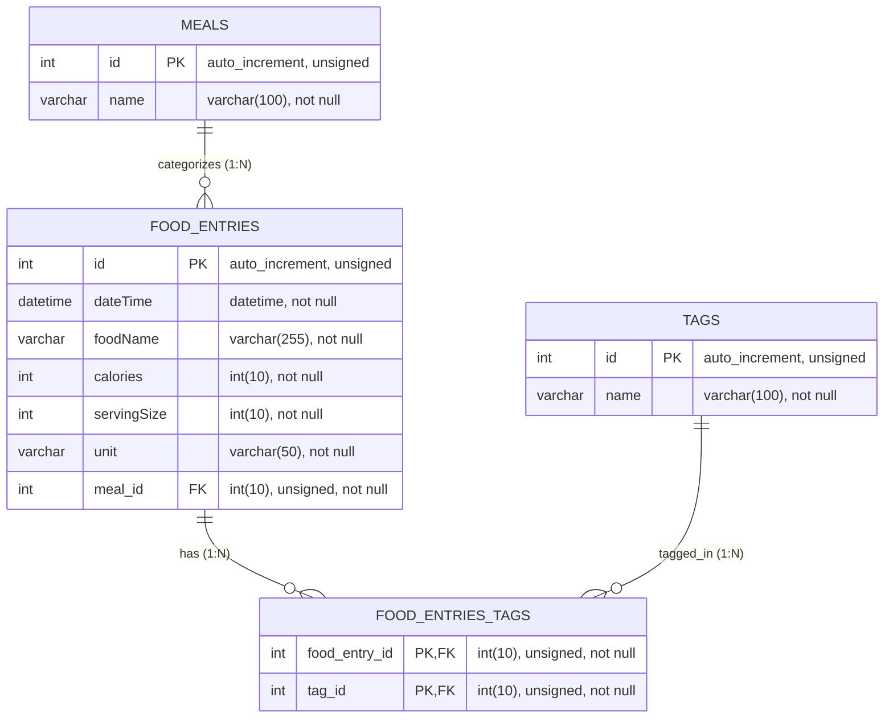

# RD4.1: Dynamic Web Applications with Express, MariaDB, and EJS — User Guide

Welcome to the **RD4.1 CRUD Application Guide**. This guide walks you through building, configuring, and using a full-stack dynamic CRUD application (Calorie-In-Calorie-Out / Food Tracker) powered by **Express.js**, **MariaDB/MySQL**, and the **EJS** template engine.

0. Logical Schema Diagram



---

### Relationship Summary

| Parent Table | Relationship | Child / Junction Table | Foreign Key Column | Reference Target | On Delete / Update |
| :--- | :---: | :--- | :--- | :--- | :--- |
| `meals` | **1 to Many** | `food_entries` | `meal_id` | `meals(id)` | `RESTRICT` |
| `food_entries` | **1 to Many** | `food_entries_tags` | `food_entry_id` | `food_entries(id)` | `CASCADE / RESTRICT` |
| `tags` | **1 to Many** | `food_entries_tags` | `tag_id` | `tags(id)` | `CASCADE / RESTRICT` |

> **Note**: `food_entries` and `tags` form a **Many-to-Many ($M:N$)** relationship resolved through the composite junction table `food_entries_tags` where `(food_entry_id, tag_id)` serves as the composite Primary Key.

---

## 1. Introduction

### What It Does
Unlike a headless REST API that only exchanges JSON data, this application is a **server-rendered dynamic web application**. Express dynamically generates HTML on the fly by combining database records with EJS templates and sending ready-to-view web pages to the client.

Key capabilities include:
- Viewing recorded food entries in an interactive table with tag badges and meal categories.
- Filtering/searching entries dynamically with keyword queries.
- Creating, editing, and deleting food entries with relational data mapping (one-to-many meal relationships and many-to-many tag associations) managed safely using database transactions.

### Who It's For
- **Full-stack web development learners and GitHub developers** transitioning from static web pages or pure REST APIs to server-side rendered (SSR) dynamic web apps.
- **Instructors and students** working through practical CRUD (Create, Read, Update, Delete) patterns with SQL databases in Node.js.

---

## 2. Getting Started

### Requirements
Ensure you have the following installed on your machine:
- **Node.js**: `v18.x` or later
- **npm**: `v9.x` or later
- **MariaDB** or **MySQL**: `v10.4+` (or access via Docker/local service)
- **Git**

### Installation & Setup

1. **Clone the repository:**
   ```bash
   git clone https://github.com/leekwan1582-at/cico.git
   cd cico
   ```

2. **Install project dependencies:**
   ```bash
   npm install
   ```

3. **Configure Environment Variables:**
   Create a `.env` file in the root directory (refer to `.env example`):
   ```env
   DB_HOST=127.0.0.1
   DB_USER=root
   DB_PASSWORD=mariadb
   DB_NAME=cico
   DB_PORT=3306
   ```

4. **Initialize Database Tables and Seed Data:**
   Run your SQL schema and seed scripts into MariaDB:
   ```bash
   mysql -u root -pmariadb -h 127.0.0.1 cico < migrations/schema.sql
   ```

5. **Start the Application:**
   ```bash
   # Using nodemon for auto-reload during development
   npx nodemon index.js
   ```
   Open your browser and navigate to: `http://localhost:3000`

[SCREENSHOT: Terminal output showing nodemon starting and server listening at http://localhost:3000]

---

## 3. Core Features

### Feature 1: View and Search Food Entries (Read)
- **Description:** Displays all logged food entries in a clean dashboard table, detailing date/time, food item, calories, serving details, meal categories, and associated tags. Includes a search bar to filter records by food name.
- **Step-by-Step Instructions:**
  1. Open your browser to `http://localhost:3000/`.
  2. Browse through the table to inspect previous entries.
  3. Enter a keyword (e.g., `"Chicken"`) into the search bar at the top and click **Search**.
  4. To reset the filter, clear the search input and submit, or click **Reset**.
- **Tips:**
  - The query uses SQL `LIKE ?` bindings with wildcards (`%searchTerm%`) to prevent SQL injection while performing case-insensitive matching.

[SCREENSHOT: Dashboard table displaying food entry items with tags and search bar]

---

### Feature 2: Add a Food Entry (Create)
- **Description:** Submit a form to register a new food item with meal category selection (Breakfast, Lunch, Dinner, Snack) and multiple tags (e.g., Healthy, Keto, Fast Food).
- **Step-by-Step Instructions:**
  1. From the home page, click **Add Food Entry** (or navigate to `/food-entry/create`).
  2. Enter the Date & Time, Food Name (e.g., `"Oatmeal Bowl"`), Calories (e.g., `350`), Serving Size, and Serving Unit.
  3. Choose a Meal type from the dropdown.
  4. Select one or more tags using the checkbox/multi-select options.
  5. Click **Submit**. You will be redirected to the home page with the new record visible.
- **Tips:**
  - Multi-tag handling uses database transactions (`beginTransaction()` / `commit()`). If adding tags fails, changes roll back automatically to keep your database clean.

[SCREENSHOT: Create Food Entry form showing inputs for food details, meal dropdown, and tag checkboxes]

---

### Feature 3: Update an Existing Food Entry (Update)
- **Description:** Pre-populates the existing entry data into an edit form, allowing you to update food properties, change the meal type, or reassign tags.
- **Step-by-Step Instructions:**
  1. On the home page table, locate the target entry and click the **Edit** button.
  2. The edit screen (`/food-entry/:id/edit`) loads with all previous values pre-selected.
  3. Modify any desired field (e.g., adjust calories or check new tags).
  4. Click **Update Entry**.
- **Tips:**
  - Notice how EJS evaluates `<%= relatedTags.includes(tag.id) ? 'checked' : '' %>` to automatically check existing tags when rendering the page.

[SCREENSHOT: Edit Food Entry view pre-populated with existing record data and pre-checked tags]

---

### Feature 4: Remove a Food Entry (Delete)
- **Description:** Safely deletes a food entry record with a dedicated confirmation step to prevent accidental deletions.
- **Step-by-Step Instructions:**
  1. On the dashboard table, click the **Delete** button next to the record.
  2. Review the confirmation prompt displaying the food item name and details (`/food-entry/:id/delete`).
  3. Click **Confirm Delete** to permanently remove the entry and return to the main list.
- **Tips:**
  - Using a `POST` request for deletion rather than a raw `GET` link prevents search engine web crawlers or accidental clicks from deleting user data.

[SCREENSHOT: Confirmation dialog/page asking user to confirm deletion of selected food item]

---

## 4. Testing

The application includes automated Unit and Integration tests using Node.js's native test runner (`node:test` and `node:assert/strict`):

```bash
# Run the complete test suite
npm test
```

### Test Scope:
- **Unit Tests ([test/unit.test.js](file:///home/leekwan/code/cico/test/unit.test.js))**: Verifies tag deduplication logic, whitespace trimming on search terms, default meal ID fallbacks, and datetime string parsing.
- **Integration Tests ([test/integration.test.js](file:///home/leekwan/code/cico/test/integration.test.js))**: Runs an ephemeral Express server with an isolated mock database pool to test HTTP status codes, form submissions (`POST /food-entry/create`, `POST /food-entry/:id/edit`, `POST /food-entry/:id/delete`), redirects, and SQL queries.

---

## 5. Frequently Asked Questions (FAQ)

### Q1: What makes this a "dynamic web application" instead of a static site?
In a static site, pre-written HTML files are served as-is. In this dynamic web application, Express processes every incoming request, queries MariaDB in real time, and passes dynamic data to EJS templates to render HTML customized for each request.

### Q2: Why use `express-ejs-layouts`?
`express-ejs-layouts` prevents repeating boilerplate HTML (such as `<head>`, navigation bars, and footer scripts) across every page. Views only need to provide their unique body content, which is injected into a shared `layout.ejs` file.

### Q3: Why are database transactions used for adding and editing entries?
When saving a food item with tags, two tables are updated: `food_entries` and `food_entries_tags`. Using `connection.beginTransaction()` guarantees that if writing tags fails, the main food entry is rolled back, preventing orphaned records.

### Q4: How does the application prevent SQL injection?
All database queries use parameterized placeholders (`?`) provided by `mysql2/promise` (e.g., `dbConnection.execute(sql, [value])`). MariaDB escapes all parameters before running the query.

### Q5: How do HTML forms handle `POST` requests without JavaScript `fetch`?
The application uses standard HTML form submissions (`method="POST" action="/..."`) paired with `app.use(express.urlencoded({ extended: true }))`, which parses submitted form fields directly into `req.body`.

---

## 6. Troubleshooting

| Issue / Error | Likely Cause | Solution |
| :--- | :--- | :--- |
| `ECONNREFUSED 127.0.0.1:3306` | MariaDB service is stopped or port is blocked. | Verify MariaDB is running with `systemctl status mariadb` or run `runmysql.sh` / `runmysql.bat`. Check credentials in `.env`. |
| `ER_NO_SUCH_TABLE` | Migrations have not been applied to the database. | Execute the database migration scripts located in `./migrations` to create the required tables. |
| Form inputs arrive as `undefined` in `req.body` | Missing body-parsing middleware. | Ensure `app.use(express.urlencoded({ extended: true }))` is placed before your route definitions in [index.js](file:///home/leekwan/code/cico/index.js#L13). |
| `Cannot find module 'ejs'` | Missing npm dependencies. | Run `npm install` to install all packages declared in [package.json](file:///home/leekwan/code/cico/package.json). |
| `TypeError: Cannot read properties of undefined (reading 'map')` | Tags or related records query returned empty or undefined. | Provide fallback defaults (e.g., `req.body.tags || []`) and verify template variable names match route parameters. |

---

## 7. Support & Feedback

If you run into issues, need assistance, or want to contribute:
- **Issue Tracker:** Submit bug reports or feature requests via GitHub Issues: [Issues · leekwan1582-at/cico](https://github.com/leekwan1582-at/cico/issues).
- **Discussions:** Start a thread in your course forum or repository discussion board.
- **Pull Requests:** PRs for bug fixes or template improvements are welcome! Please make sure your code runs cleanly with `npm test` before submitting.