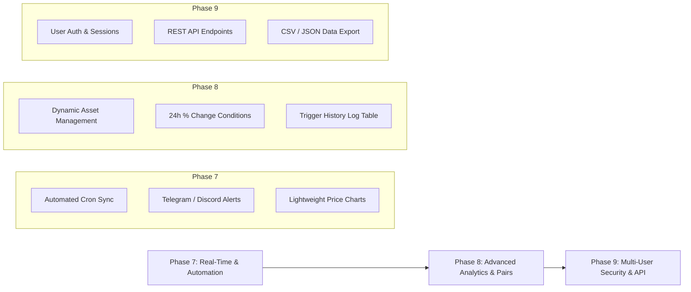

# Phase 7 & Beyond: Feature Proposal & Roadmap (`crypto_alerts`)

This document outlines proposed feature enhancements for subsequent development phases of the **Crypto Daily Alerts (`crypto_alerts`)** web application. These proposals build on the foundational 3-tier architecture (Presentation, Business Logic, Data Storage), relational database design, and CCXT market price integration.

---

## 1. Feature Overview & Priority Matrix

| Feature | Category | Complexity | Impact / Value | Target Phase |
| :--- | :--- | :--- | :--- | :--- |
| **1. Multi-Channel Alert Notifications** | Integrations / Core Logic | Medium | High (real-time notification delivery) | Phase 7 |
| **2. Historical Price Chart & Trigger Timeline** | UI / Visualization | Medium | High (visual context for technical traders) | Phase 7 |
| **3. Automated Cron Scheduler & Health Check** | Automation / DevOps | Low | High (hands-free price monitoring) | Phase 7 |
| **4. Asset Portfolio & Watchlist Expansion** | Data & CRUD | Medium | Medium (broadens crypto coverage) | Phase 8 |
| **5. Advanced Alert Conditions (Trailing & % Change)** | Business Logic / SQL | High | High (professional trading rules) | Phase 8 |
| **6. User Authentication & Role-Based Access Control** | Security / Auth | Medium | High (multi-tenant privacy & safety) | Phase 9 |
| **7. RESTful API & Webhook Export** | Developer API | Low | Medium (external automation & bots) | Phase 9 |

---

## 2. Detailed Feature Specifications

### 2.1 Multi-Channel Alert Notifications (Telegram / Discord / Email)
- **Objective**: Notify users immediately when an alert switches from `ACTIVE` to `TRIGGERED`, rather than relying solely on dashboard visits.
- **Implementation**:
  - Add `notification_channel` (`EMAIL`, `TELEGRAM`, `DISCORD`, `IN_APP`) and `recipient_target` (chat ID or email address) to `price_alerts` or a dedicated `notification_preferences` table.
  - Integrate lightweight webhook dispatchers (e.g., Telegram Bot API `sendMessage`, Discord Webhook POST).
  - Create a new service: `services/notificationService.js`.
  - When `priceService.refreshAllPrices()` detects a trigger transition (`is_triggered` changes from `FALSE` to `TRUE`), dispatch notifications asynchronously without blocking the database transaction.

### 2.2 Historical Price Charts & Alert Overlay (ApexCharts.js)
- **Objective**: Display an interactive 7-day or 30-day D1 candlestick/line chart directly on the dashboard when selecting an asset, complete with active alert price threshold overlays.
- **Implementation**:
  - Use **ApexCharts.js** via ``.
  - Fetch OHLCV candle history via CCXT (`exchange.fetchOHLCV(symbol, '1d', since, 30)`).
  - Persist daily candles in MySQL via `asset_ohlcv` table with unique constraint `(asset_id, candle_time)` for fast, cached queries and offline resilience.
  - Expose `GET /api/assets/:id/chart-data` to serve candles and active `price_alerts` target price threshold lines.
  - Overlay horizontal Y-axis annotations color-coded by condition type (`ABOVE` in green `#10b981`, `BELOW` in red `#ef4444`).
  - Automatically adapt to light/dark themes via `MutationObserver` on `data-bs-theme`.
  - *(See full specification in [apexcharts_candlestick_implementation_plan.md](file:///home/leekwan/code/cico/crypto_alerts/docs/apexcharts_candlestick_implementation_plan.md))*.

### 2.3 Automated Cron-Based Price Polling & System Health Monitor
- **Objective**: Automate daily or hourly price synchronizations in the background so alerts trigger without requiring manual clicks on `[ Refresh D1 Prices ]`.
- **Implementation**:
  - Install `node-cron` or utilize native scheduler.
  - Configure scheduled execution at daily market close (00:00 UTC) and optional periodic intervals (e.g., every hour).
  - Add a dedicated `/health` or `/status` endpoint returning DB connection status, active exchange latency, last sync timestamp, and total active vs. triggered alerts.

### 2.4 Dynamic Asset Watchlist & Pair Management
- **Objective**: Enable users to add custom cryptocurrency pairs beyond the default BTC, ETH, and SOL (e.g., XRP, ADA, DOGE, NEAR).
- **Implementation**:
  - Expand CRUD capabilities to include `GET /assets`, `POST /assets` (Add Asset), and `POST /assets/:id/delete`.
  - Validate candidate trading pairs against CCXT exchange markets (`exchange.loadMarkets()`) prior to saving.
  - Dynamically populate the KPI strip and asset dropdowns based on active watchlist items.

### 2.5 Advanced Alert Types (Percentage Change & Trailing Stops)
- **Objective**: Support condition types beyond static price levels.
- **Proposed Conditions**:
  - `PCT_CHANGE_24H_ABOVE` / `PCT_CHANGE_24H_BELOW` (e.g., alert if 24h change > +5% or < -10%).
  - `TRAILING_STOP` (alerts when price drops $X$ or $X\%$ below highest observed peak).
- **Database Schema Changes**:
  - Add `condition_metric` (`PRICE`, `PCT_CHANGE_24H`) to `price_alerts`.
  - Add `reference_baseline` to store initial entry prices for relative calculations.

### 2.6 User Authentication & Privacy Isolation (Session / JWT)
- **Objective**: Provide true user login and prevent users from modifying or viewing another trader's private alerts.
- **Implementation**:
  - Add `password_hash` column to `users` table using `bcrypt`.
  - Integrate `express-session` with session storage or JWT cookies.
  - Introduce `authMiddleware` to protect `/alerts*` routes, scoping all database queries automatically to `req.session.userId`.

### 2.7 Export, Import & Webhooks API
- **Objective**: Allow power users to back up, import, or integrate their alert configurations with third-party tools (TradingView webhooks, Google Sheets, cURL).
- **Implementation**:
  - Add `GET /api/v1/alerts` and `POST /api/v1/alerts` returning standardized JSON payloads.
  - Provide **CSV / JSON Export** button on the dashboard.
  - Provide an incoming webhook receiver (`POST /api/v1/webhooks/price-update`) allowing external signals (TradingView alerts) to trigger watchlist evaluations.

---

## 3. Recommended Phasing & Roadmap

---

## 4. Next Action Items

1. **Review Proposals**: Confirm preferred priority order (e.g., start with **Phase 7: Background Cron + Telegram Alerts** or **Phase 7: Interactive Price Charts**).
2. **Database Migration Script**: When adding new tables or columns, create incremental SQL migration files in `sql/migrations/` (e.g., `002_add_notifications.sql`).
3. **Test Suite Expansion**: Maintain integration test coverage with corresponding mocks for third-party webhook dispatchers and schedulers.
