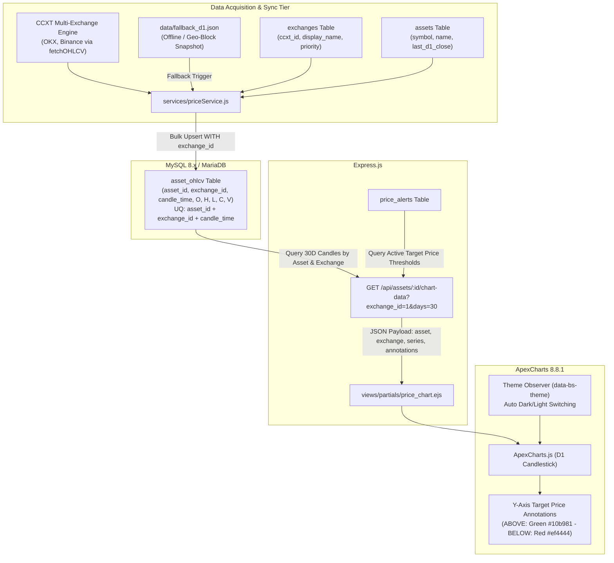

# Detailed Implementation Plan: Historical Price Candlestick Charts & Alert Overlay (ApexCharts.js)

This document provides the technical architecture and step-by-step implementation plan for **Interactive D1 Candlestick / Line Charts with Alert Overlays** using **ApexCharts.js**, backed by persistent database storage for historical OHLCV candle data partitioned by **Asset** and **Exchange**.

---

## 1. Architecture & Data Flow Overview



---

## 2. Database Schema Extension & Master Table Clarification

### 2.1 Role of `assets` and `exchanges` as Master Tables
- **`assets` table serves as the Asset Master**: Stores canonical asset definitions (`symbol`, `name`).
- **`exchanges` table serves as the Exchange Master**: Stores supported venues (`ccxt_id`, `display_name`, `priority_order`).
- **`asset_ohlcv` table serves as the Fact / Historical Ledger**: Retains individual daily candles distinctly identified by both `asset_id` **and** `exchange_id`.

### 2.2 Table DDL: `asset_ohlcv` with `exchange_id`
Create a dedicated historical table with a composite unique index on `(asset_id, exchange_id, candle_time)` to support idempotent updates (`INSERT ... ON DUPLICATE KEY UPDATE`):

```sql
-- Table 5: Asset OHLCV Historical Candles (Partitioned by Asset & Exchange)
CREATE TABLE IF NOT EXISTS asset_ohlcv (
    id BIGINT UNSIGNED AUTO_INCREMENT PRIMARY KEY,
    asset_id INT UNSIGNED NOT NULL,
    exchange_id INT UNSIGNED NOT NULL,                 -- Identifies exact exchange origin (OKX, Binance, Local)
    candle_time DATE NOT NULL,                         -- Day timestamp (YYYY-MM-DD)
    open_price DECIMAL(18, 8) NOT NULL,
    high_price DECIMAL(18, 8) NOT NULL,
    low_price DECIMAL(18, 8) NOT NULL,
    close_price DECIMAL(18, 8) NOT NULL,
    volume DECIMAL(24, 8) DEFAULT 0.0,
    created_at DATETIME DEFAULT CURRENT_TIMESTAMP,
    updated_at DATETIME DEFAULT CURRENT_TIMESTAMP ON UPDATE CURRENT_TIMESTAMP,
    UNIQUE KEY uq_asset_exchange_candle (asset_id, exchange_id, candle_time),
    FOREIGN KEY (asset_id) REFERENCES assets(id) ON DELETE CASCADE,
    FOREIGN KEY (exchange_id) REFERENCES exchanges(id) ON DELETE CASCADE
);
```

> **Why `UNIQUE KEY (asset_id, exchange_id, candle_time)`?**
> Different exchanges report slight price discrepancies and distinct trading volumes for the same trading pair (e.g. BTC/USDT on OKX vs. Binance). By including `exchange_id`, each exchange maintains its own authentic historical series without overwriting or polluting other exchanges.

---

## 3. CCXT Historical Data Fetching & Sync Logic

### 3.1 CCXT Multi-Exchange OHLCV Fetching Method
In `services/priceService.js`, fetch the last 30 daily candles per active exchange via CCXT:

```javascript
// Fetch 30-day D1 candles for a specific exchange and asset
const since = Date.now() - 30 * 24 * 60 * 60 * 1000;
const ohlcv = await exchangeInstance.fetchOHLCV(asset.symbol, '1d', since, 30);
// Each candle returned: [ timestamp, open, high, low, close, volume ]
```

### 3.2 Idempotent Database Batch Upsert
Persist fetched candles into `asset_ohlcv` inside a transaction block:

```javascript
async function saveCandlesToDatabase(connection, assetId, exchangeId, candles) {
  const insertSql = `
    INSERT INTO asset_ohlcv (asset_id, exchange_id, candle_time, open_price, high_price, low_price, close_price, volume)
    VALUES ?
    ON DUPLICATE KEY UPDATE
      open_price = VALUES(open_price),
      high_price = VALUES(high_price),
      low_price = VALUES(low_price),
      close_price = VALUES(close_price),
      volume = VALUES(volume),
      updated_at = NOW()
  `;

  const values = candles.map((c) => {
    // c[0] is epoch ms timestamp
    const dateStr = new Date(c[0]).toISOString().slice(0, 10);
    return [assetId, exchangeId, dateStr, c[1], c[2], c[3], c[4], c[5]];
  });

  if (values.length > 0) {
    await connection.query(insertSql, [values]);
  }
}
```

### 3.3 Offline / Geo-Block Fallback Generation
If external exchange APIs are unreachable due to network isolation or geo-blocking, generate 30 days of synthetic historical candles tagged with `exchange_id = 3` (`Offline D1 Snapshot`) anchored to `data/fallback_d1.json`.

---

## 4. Backend Express API Endpoint

Expose a clean JSON endpoint for the frontend chart component:

### `GET /api/assets/:id/chart-data`

- **Query Parameters**:
  - `exchange_id`: ID of the exchange to inspect (defaults to priority 1 / OKX Singapore).
  - `user_id`: (optional) Filters alert overlay lines to the active user.
  - `days`: Number of historical candles (default: `30`, options: `7` or `30`).
- **Output JSON Payload**:
```json
{
  "asset": {
    "id": 1,
    "symbol": "BTC/USDT",
    "name": "Bitcoin",
    "last_d1_close": 89200.0
  },
  "exchange": {
    "id": 1,
    "ccxt_id": "okx",
    "display_name": "OKX Singapore"
  },
  "series": [
    {
      "x": "2026-11-01",
      "y": [87100.0, 88500.0, 86800.0, 88200.0]  // [Open, High, Low, Close]
    }
  ],
  "annotations": [
    {
      "id": 4,
      "target_price": 90000.0,
      "condition_type": "ABOVE",
      "borderColor": "#10b981",
      "label": "Target: ABOVE $90,000 (leekwan)"
    },
    {
      "id": 5,
      "target_price": 84000.0,
      "condition_type": "BELOW",
      "borderColor": "#ef4444",
      "label": "Target: BELOW $84,000 (leekwan)"
    }
  ]
}
```

---

## 5. Frontend UI Component & ApexCharts Integration

### 5.1 CDN Integration in `views/layout` / `views/index.ejs`
```html
<!-- ApexCharts 8.8.1 CDN -->
<script src="https://cdn.jsdelivr.net/npm/apexcharts@8.8.1/dist/apexcharts.min.js"></script>
```

### 5.2 Chart Container Partial (`views/partials/price_chart.ejs`)
Includes paired selectors for both **Asset** and **Exchange**:

```html
<div class="card shadow-sm mb-4 border-0">
  <div class="card-header bg-body-tertiary d-flex flex-wrap justify-content-between align-items-center gap-2">
    <div class="d-flex align-items-center gap-2">
      <span class="fw-semibold">Asset Candlestick Chart (D1)</span>
      <!-- Asset Selector -->
      <select id="chartAssetSelect" class="form-select form-select-sm" style="width: auto;">
        <% assets.forEach(function(asset) { %>
          <option value="<%= asset.id %>"><%= asset.symbol %> (<%= asset.name %>)</option>
        <% }); %>
      </select>
      <!-- Exchange Selector -->
      <select id="chartExchangeSelect" class="form-select form-select-sm" style="width: auto;">
        <% exchanges.forEach(function(ex) { %>
          <option value="<%= ex.id %>"><%= ex.display_name %></option>
        <% }); %>
      </select>
    </div>
    <div class="btn-group btn-group-sm" role="group">
      <button type="button" class="btn btn-outline-secondary active" data-days="7">7D</button>
      <button type="button" class="btn btn-outline-secondary" data-days="30">30D</button>
    </div>
  </div>
  <div class="card-body p-2">
    <div id="apexCandleChart" style="min-height: 350px;"></div>
  </div>
</div>
```

### 5.3 ApexCharts Configuration & Alert Overlay Script (`public/js/chart.js`)

```javascript
let chartInstance = null;

async function loadChart(assetId, exchangeId = 1, days = 30) {
  const url = `/api/assets/${assetId}/chart-data?exchange_id=${exchangeId}&days=${days}`;
  const response = await fetch(url);
  const data = await response.json();

  // Map alert targets to ApexCharts Y-Axis annotations
  const yaxisAnnotations = (data.annotations || []).map((alert) => {
    const isAbove = alert.condition_type === "ABOVE";
    const color = isAbove ? "#10b981" : "#ef4444";
    return {
      y: alert.target_price,
      borderColor: color,
      strokeDashArray: 4,
      label: {
        borderColor: color,
        style: {
          color: "#fff",
          background: color,
          fontSize: "11px",
          fontWeight: 600,
        },
        text: `${alert.condition_type} $${Number(alert.target_price).toLocaleString()}`,
      },
    };
  });

  const isDarkMode = document.documentElement.getAttribute("data-bs-theme") === "dark";

  const options = {
    series: [{
      name: "D1 Candle",
      data: data.series, // [{ x: 'YYYY-MM-DD', y: [open, high, low, close] }]
    }],
    chart: {
      type: "candlestick",
      height: 350,
      toolbar: { show: true, tools: { zoom: true, reset: true } },
      background: "transparent",
    },
    title: {
      text: `${data.asset.symbol} on ${data.exchange.display_name} - ${days}D D1 Candles with Active Price Alerts`,
      align: "left",
      style: { fontSize: "14px", fontWeight: 600 },
    },
    annotations: {
      yaxis: yaxisAnnotations,
    },
    xaxis: {
      type: "datetime",
      labels: { datetimeUTC: false },
    },
    yaxis: {
      tooltip: { enabled: true },
      labels: {
        formatter: (val) => `$${Number(val).toLocaleString(undefined, { minimumFractionDigits: 2 })}`,
      },
    },
    theme: {
      mode: isDarkMode ? "dark" : "light",
    },
  };

  if (chartInstance) {
    chartInstance.destroy();
  }
  chartInstance = new ApexCharts(document.querySelector("#apexCandleChart"), options);
  await chartInstance.render();
}

// Observe Bootstrap 5 dark/light theme changes and update chart dynamically
const observer = new MutationObserver(() => {
  if (chartInstance) {
    const isDark = document.documentElement.getAttribute("data-bs-theme") === "dark";
    chartInstance.updateOptions({ theme: { mode: isDark ? "dark" : "light" } });
  }
});
observer.observe(document.documentElement, { attributes: true, attributeFilter: ["data-bs-theme"] });
```

---

## 6. Implementation Checklist & Phase Steps

- [ ] **Step 1: Database Migration**:
  - Add `asset_ohlcv` table definition with `exchange_id` and foreign key reference into `sql/schema.sql`.
  - Update `seed.js` to seed baseline 30-day historical candles partitioned across OKX and Binance.
- [ ] **Step 2: Service Layer (`priceService.js`)**:
  - Implement `fetchAndSaveOHLCV(assetId, exchangeId, symbol, days)` with CCXT `fetchOHLCV` and offline fallback.
  - Connect sync inside `refreshAllPrices()` to update both latest D1 close and exchange-specific historical candle rows.
- [ ] **Step 3: Route Layer (`alertRoutes.js`)**:
  - Implement `GET /api/assets/:id/chart-data`.
  - Filter `asset_ohlcv` by both `asset_id` and `exchange_id`.
  - Perform JOIN on `price_alerts` matching the requested asset and exchange where `is_triggered = FALSE`.
- [ ] **Step 4: Frontend View & Script**:
  - Add ApexCharts 8.8.1 CDN `<script>` tag.
  - Render `views/partials/price_chart.ejs` with Asset and Exchange dropdowns.
  - Create `public/js/chart.js` with dynamic theme observation.
- [ ] **Step 5: Testing & Verification**:
  - Add integration tests for `GET /api/assets/:id/chart-data` verifying multi-exchange query filters and fallback data.
