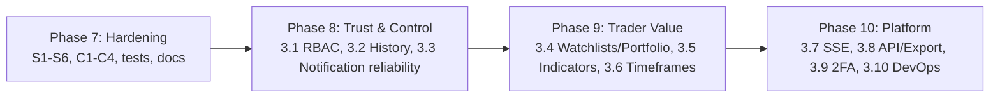

# Crypto Alerts — Codebase Gap Analysis & Next-Phase Proposal

**Audit date:** 2026-11-20
**Scope:** `/home/leekwan/code/cico/crypto_alerts` (routes, services, middleware, views, SQL, seed, tests, docs)
**Baseline:** 50/50 tests passing. Note that every test runs against a mocked DB, so a green suite does not prove the findings below are absent.

Severity: 🔴 Critical · 🟠 High · 🟡 Medium · 🔵 Low

---

## 1. Executive Summary

The feature work is broad (candlestick charts, multi-channel notifications, cron, watchlist, advanced alert types, JWT auth). The weak spot is that **authentication was added to the alert routes only**. Several state-changing endpoints are still public, including one that wipes the database. There are also correctness bugs in the alert evaluation engine and client-side XSS paths.

| # | Finding | Severity | Location |
|---|---|---|---|
| S1 | `POST /reset-db` is unauthenticated: anyone can wipe and re-seed the DB | 🔴 | `routes/alertRoutes.js:540` |
| S2 | `/refresh`, `/assets`, `POST /assets`, `POST /assets/:id/delete`, chart and catalog APIs are unauthenticated | 🔴 | `alertRoutes.js:522, 763, 797, 862, 559, 907` |
| S3 | Assets are global: deleting one cascades into **other users'** alerts | 🔴 | schema FK `ON DELETE CASCADE` + S2 |
| S4 | Stored/DOM XSS: user-controlled `name`/`username` interpolated into `innerHTML` | 🟠 | `views/index.ejs:466, 476, 697, 802–816` |
| S5 | Open redirect: `startsWith("/")` accepts `//evil.com` | 🟠 | `alertRoutes.js:78` |
| S6 | Schema `DEFAULT` password hash: any user row inserted without a password can log in with `password123` | 🟠 | `sql/schema.sql` users table |
| S7 | No CSRF protection on cookie-authenticated POST forms; logout accepts GET (`router.all`) | 🟡 | `alertRoutes.js:143`, all forms |
| S8 | Hard-coded `JWT_SECRET` fallback; cookie lacks `Secure`; no login rate limiting; no security headers | 🟡 | `services/authService.js`, `index.js` |
| C1 | Triggered alerts silently **reset to FALSE** when price retreats, so notifications re-fire on every crossing | 🟠 | `services/priceService.js:250` (`ELSE FALSE`) |
| C2 | `prev_d1_close` query ignores `exchange_id`, so the "previous" candle can be the same day from another exchange and 24h % is wrong | 🟠 | `priceService.js:140` |
| C3 | Alerts store `exchange_id`, but evaluation always uses the single global `assets.last_d1_close` | 🟡 | `priceService.js` evaluation SQL |
| C4 | `POST /assets` makes CCXT network calls **inside an open DB transaction** (row locks held for seconds) | 🟡 | `alertRoutes.js:826–835` |

---

## 2. Security Gaps (Detail)

### S1/S2 — Unprotected endpoints 🔴
`requireAuth` is applied to `/`, `/alerts*`, and `/profile` only. These routes have **no middleware**:

| Route | Risk |
|---|---|
| `POST /reset-db` | Truncates every table, including all users and alerts |
| `POST /refresh` | Unthrottled outbound CCXT calls (DoS / exchange rate-limit ban) |
| `GET/POST /assets`, `POST /assets/:id/delete` | Anonymous watchlist tampering |
| `GET /api/assets/:id/chart-data` | Leaks alert annotations (target prices) |
| `GET /api/markets/catalog`, `/health` | Low risk; review intentionally |

**Fix:** apply `requireAuth` globally after the auth routes, with an explicit allow-list (`/login`, `/register`, `/health`). Gate `/reset-db` behind an admin role **and** `NODE_ENV !== 'production'`.

### S3 — Shared asset ownership 🔴
`assets` has no `user_id`. One trader deleting `BTC/USDT` cascades through `price_alerts.asset_id ON DELETE CASCADE` and deletes every user's BTC alerts. This defeats the privacy isolation goal of Feature 2.6.
**Fix:** introduce a `user_watchlist(user_id, asset_id)` join table. Keep `assets` as a shared master list, and only remove the user's watchlist row on delete.

### S4 — XSS 🟠
Template literals inject `a.name`, `c.name`, `user.username`, and `user.email` into SweetAlert `html` and `innerHTML`. Asset names come from `POST /assets`, which is user input and currently unauthenticated. A name like `` executes for every viewer.
**Fix:** add an `escapeHtml()` helper for all interpolations, or build DOM nodes with `textContent`. Validate `name` server-side (length ≤ 50, character allow-list).

### S5 — Open redirect 🟠
`redirectParam.startsWith("/")` passes `//evil.com/phish`.
**Fix:** require `/^\/(?!\/)/` and reject backslashes.

### S6 — Default password in DDL 🟠
`password_hash ... NOT NULL DEFAULT '<hash of password123>'` means any insert path that forgets the password column creates a loginable account with a known password.
**Fix:** keep the default only in the one-off migration `UPDATE`. Make the DDL `NOT NULL` with **no default**. Also add a `must_change_password` flag for seeded accounts.

### S7/S8 — Hardening 🟡
- No CSRF tokens. `SameSite=Lax` blocks most cross-site POSTs but not same-site attacks; `GET /logout` is trivially forgeable.
- `JWT_SECRET` falls back to a public constant. The app should **refuse to start** in production without it.
- The cookie is missing `Secure`, and there is no token revocation (a password change does not invalidate old tokens).
- `/login` has no brute-force throttling. `helmet`-style headers (CSP, X-Frame-Options) are not set.
- `register` and `profile` do not enforce length limits that match `VARCHAR(50)`/`VARCHAR(100)`, so oversized input causes a 500.

---

## 3. Correctness / Execution Gaps

| ID | Gap | Impact | Fix |
|---|---|---|---|
| C1 | `is_triggered = CASE ... ELSE FALSE END` re-arms alerts automatically and clears `triggered_at` | Notification spam and lost trigger history | Only transition FALSE→TRUE in the engine. Re-arming is an explicit user action (already done on edit). |
| C2 | `ORDER BY candle_time DESC LIMIT 2` has no `exchange_id` filter | Wrong 24h %, so `PCT_CHANGE_*` alerts misfire | Filter by the source exchange, or `SELECT DISTINCT candle_time` |
| C3 | Per-alert exchange is ignored during evaluation | The "OKX vs Binance" choice in the UI has no effect | Evaluate against the latest `asset_ohlcv` close for `pa.exchange_id` |
| C4 | CCXT fetch inside the transaction | Lock contention, timeouts, long rollbacks | Fetch candles first, then open a short transaction to insert |
| C5 | `refreshAllPrices` runs sequential per-asset/per-exchange network calls with 6s timeouts | Offline runs with N assets take ~N×24s | Parallelise with `Promise.allSettled` plus a concurrency cap, or cache `loadMarkets()` |
| C6 | `validateAssetSymbol` instantiates a new exchange and calls `loadMarkets()` per request | Slow and rate-limit prone | Cache the markets map in memory with a TTL |
| C7 | Offline validation accepts **any** `XXX/USDT` | Junk pairs get seeded with fake 180-day candles | Mark the asset as `unverified` and disable alerts until a live check succeeds |
| C8 | Scheduler is in-process with no lock | Multiple instances (PM2 cluster, Docker replicas) duplicate syncs and notifications | DB advisory lock (`GET_LOCK`) or a `job_runs` table |
| C9 | Notification dispatch is fire-and-forget (`setImmediate`) with no retry or log table | Failed Telegram/Discord sends are lost silently | `notification_log` table with status and retry count |
| C10 | Email channel is console-simulated only | The EMAIL option is cosmetic | Wire nodemailer/SMTP via `.env` |
| C11 | Profile update has no transaction; changing the username leaves the stale "Remember me" value in localStorage | Minor UX inconsistency | Update localStorage after a successful save |

---

## 4. Data Layer & Migrations

| Gap | Severity | Note |
|---|---|---|
| No migration runner or `schema_migrations` tracking table; 001–004 must be applied manually in order | 🟡 | Add a small `migrate.js` that records applied files |
| Migrations hard-code `crypto_alerts_db` instead of honouring `DB_NAME` | 🟡 | Breaks for any other DB name |
| `schema.sql` uses `CREATE TABLE` without `IF NOT EXISTS` for 4 of 5 tables | 🔵 | Re-running fails midway |
| Missing indexes: `price_alerts(user_id, is_triggered)`, `price_alerts(asset_id, is_triggered)` | 🟡 | The dashboard and the engine both filter on these |
| `condition_type` / `notification_channel` are free `VARCHAR`s | 🔵 | Use `ENUM` or `CHECK` constraints |
| Seed reuses one salt for both users | 🔵 | Harmless for dev, but it teaches a bad pattern |
| No `ON UPDATE` audit columns (`updated_at`) on `price_alerts` / `users` | 🔵 | Useful for the history features below |

---

## 5. Testing Gaps

- **All route tests mock `pool.query`.** No test runs real SQL, so syntax errors in the advanced trigger `CASE` expressions or migration DDL are invisible. Add a MariaDB/MySQL service (Docker or GitHub Actions) integration stage.
- **IDOR is not actually tested.** The mock always returns `affectedRows: 1`, so a missing `AND user_id = ?` would still pass. Assert the SQL params and add a user-B-cannot-touch-user-A test.
- No tests for `POST /login`, `POST /register`, wrong-password, duplicate registration, open-redirect, or unauthenticated access to `/reset-db` and `/assets`.
- No tests exercise `refreshAllPrices` trigger logic for `PCT_CHANGE_*` and `TRAILING_STOP` against data (only formula unit tests exist).
- The test title says "defines all 4 required tables", but there are now 5. Assertions do not cover `asset_ohlcv` or the auth columns.
- No coverage reporting (`node --test --experimental-test-coverage`) and no CI workflow.

---

## 6. Documentation & Packaging Omissions

| Item | Status |
|---|---|
| `docs/er-diagram.svg` and `logical_schema_diagrame.md` | ❌ Outdated: missing `password_hash/salt`, `prev_d1_close`, `change_24h_pct`, `condition_metric`, `reference_baseline`, `peak_price` |
| README (setup, migration order, env vars, default accounts) | ❌ Missing |
| `package.json` | `description` empty; no `start` or `migrate` script |
| Stray `.env example` file (with a space) alongside `.env.example` | ❌ Duplicate, and it is shipped in `crypto_alerts.zip` |
| `docs/99_next_phase_features_proposal.md` | Partly superseded: items 2.1–2.6 are now implemented |
| Typo: `logical_schema_diagrame.md` | 🔵 Should be `diagram` |
| API reference for JSON endpoints (`/assets`, `/profile`, `/api/*`, `/health`) | ❌ Missing |

---

## 7. Recommended Remediation Order (Phase 7 — "Hardening")

Fix these before adding any new features:

1. **Global auth guard plus admin-only `/reset-db`** (S1, S2)
2. **Per-user watchlist table** (S3)
3. **HTML escaping in all modal templates** (S4)
4. **Open-redirect fix and DDL default removal** (S5, S6)
5. **Alert engine fixes**: one-way trigger transition, exchange-aware pricing, correct prev-close (C1–C3)
6. **Move CCXT calls out of transactions and cache markets** (C4, C6)
7. **Real-DB integration tests plus IDOR/auth tests** (§5)
8. **Refresh the ER diagram, add a README, remove the stray `.env example`, add npm scripts** (§6)

---

## 8. Next-Phase Feature Proposals (Phase 8+)

### 3.1 Role-Based Access Control (Admin vs Trader)
Add `users.role ENUM('ADMIN','TRADER')` and a `requireRole('ADMIN')` middleware. Admin-only actions: reset DB, manage exchanges, manage the shared asset master, view system health detail. *Prerequisite for safely exposing S1 functions.*

### 3.2 Alert History & Audit Trail
New `alert_events(alert_id, event_type, price_at_event, metric_value, created_at)` table that records CREATED / TRIGGERED / RE-ARMED / NOTIFIED / FAILED. Add a dashboard timeline and plot trigger markers on the candlestick chart. *Solves C1 and C9 visibility.*

### 3.3 Notification Reliability Layer
`notification_log` with retry/backoff, a per-user notification preferences page (default channel, quiet hours), a real SMTP integration, and a "Send test notification" button. Encrypt Telegram/Discord targets at rest.

### 3.4 Per-User Watchlists & Portfolio View
Build on the S3 fix: users curate their own watchlist order, pin favourites, and optionally record holdings (`qty`, `avg_cost`) to show unrealised P/L alongside the KPI strip.

### 3.5 Technical-Indicator Alerts
Extend `condition_metric` with `RSI_14`, `SMA_CROSS` (e.g. 50/200 golden/death cross), and `VOLUME_SPIKE` (volume > N× 20-day average). All of these can be computed from the existing `asset_ohlcv` table.

### 3.6 Multi-Timeframe Candles
Add `timeframe` (`1h`, `4h`, `1d`, `1w`) to `asset_ohlcv` (part of the unique key) and a chart timeframe toggle. This enables intraday alerts beyond D1 close.

### 3.7 Real-Time Updates
Server-Sent Events (`/api/stream`) push price refreshes and trigger events to open dashboards, replacing manual reloads. SSE is lighter than WebSockets and fits Express without new infrastructure.

### 3.8 Data Export & REST API
`GET /api/alerts.csv` / `.json` export, plus personal API tokens (scoped and revocable) for automation, with OpenAPI documentation.

### 3.9 Account Security Enhancements
Password reset via emailed one-time token, optional TOTP 2FA, session revocation (a `token_version` column incremented on password change), and login rate limiting.

### 3.10 Operations & Deployment
`Dockerfile` + `docker-compose.yml` (app + MariaDB), a GitHub Actions CI pipeline (lint, tests with coverage, real-DB integration), structured logging (pino), and `/metrics` for Prometheus.

---

## 9. Suggested Phase Roadmap

| Phase | Effort (est.) | Exit criteria |
|---|---|---|
| 7 Hardening | 2–3 days | No unauthenticated mutating routes; XSS/redirect fixed; real-DB tests green; ER diagram current |
| 8 Trust & Control | 3–4 days | Admin role enforced; every trigger and notification persisted and visible |
| 9 Trader Value | 4–6 days | Per-user watchlists; RSI/SMA alerts firing from stored candles |
| 10 Platform | 4–5 days | Dockerised; CI on every push; live dashboard updates |
