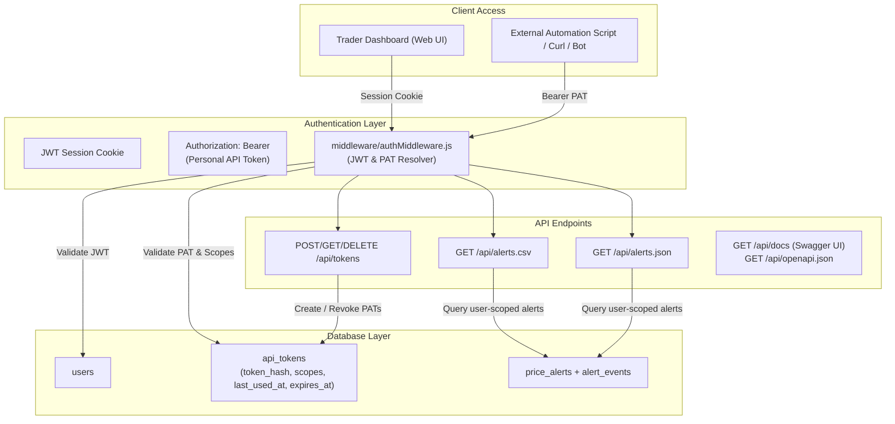

# Implementation Plan: 3.8 Data Export & REST API

> **Goal**: Implement secure data export (`GET /api/alerts.csv` and `GET /api/alerts.json`), scoped and revocable Personal API Tokens (PATs) for programmatic automation, and an interactive OpenAPI 3.0 specification (`/api/docs`).

---

## 1. Architecture & Design Overview



---

## 2. Proposed Changes & Components

### 2.1 Database Schema: `api_tokens` (`sql/014_add_api_tokens.sql`)
Add a dedicated table to support revocable personal API tokens hashed using SHA-256 (never stored in plaintext):

```sql
CREATE TABLE IF NOT EXISTS api_tokens (
    id INT AUTO_INCREMENT PRIMARY KEY,
    user_id INT NOT NULL,
    name VARCHAR(100) NOT NULL COMMENT 'Descriptive token name (e.g. My Python Script)',
    token_prefix VARCHAR(12) NOT NULL COMMENT 'First 8 chars for identification (e.g. cpat_a1b2c3d4)',
    token_hash VARCHAR(64) NOT NULL COMMENT 'SHA-256 hash of secret token',
    scopes VARCHAR(255) NOT NULL DEFAULT 'read:alerts' COMMENT 'Comma-separated scopes: read:alerts,write:alerts,read:markets',
    last_used_at DATETIME NULL,
    expires_at DATETIME NULL,
    created_at DATETIME DEFAULT CURRENT_TIMESTAMP,
    CONSTRAINT fk_api_tokens_user FOREIGN KEY (user_id) REFERENCES users(id) ON DELETE CASCADE,
    INDEX idx_api_tokens_hash (token_hash),
    INDEX idx_api_tokens_user (user_id)
) ENGINE=InnoDB DEFAULT CHARSET=utf8mb4 COLLATE=utf8mb4_unicode_ci;
```

---

### 2.2 Scoped Token Authentication Service (`services/tokenService.js`)
Create a token management module:
1. **Token Generation**:
   - Generates crypto-random string prefixed with `cpat_` (Crypto Personal Access Token), e.g., `cpat_<32_random_bytes_hex>`.
   - Computes SHA-256 hash for secure database persistence.
   - Returns plaintext token **once** upon creation.
2. **Token Verification & Scopes Check**:
   - `verifyToken(rawToken, requiredScope)`:
     - Hashes `rawToken` with SHA-256.
     - Looks up active, unexpired record in `api_tokens`.
     - Validates that `scopes` contains `requiredScope` (e.g., `read:alerts`, `write:alerts`).
     - Updates `last_used_at = NOW()` asynchronously.
3. **Revocation**:
   - Allows users to list their tokens (masking the secret, displaying prefix, scopes, created date, and last used date) and delete/revoke tokens immediately.

---

### 2.3 Authentication Middleware Enhancement (`middleware/authMiddleware.js`)
Enhance `requireAuth` and introduce `requireScope(scope)`:
- In `requireAuth`: If `Authorization: Bearer cpat_...` is supplied, authenticate via `tokenService.verifyToken()`. Attach `{ id: user.id, username: user.username, role: user.role, isApiToken: true, tokenScopes: [...] }` to `req.user`.
- `requireScope(scope)`: Middleware guard ensuring either a full session (JWT) or an API token with matching scope.

---

### 2.4 Data Export Endpoints (`routes/alertRoutes.js`)
Add data export endpoints with streaming output, RFC 4180 CSV compliance, and anti-CSV-injection sanitization:

1. **`GET /api/alerts.csv`**:
   - Header: `Content-Type: text/csv; charset=utf-8`
   - Header: `Content-Disposition: attachment; filename="crypto_alerts_export_YYYY-MM-DD.csv"`
   - Output columns:
     `ID,Asset,Exchange,Condition,Target_Price,Baseline_Price,Peak_Price,Triggered,Triggered_At,Channel,Created_At`
   - Sanitization: Prefix dangerous characters (`=`, `+`, `-`, `@`) with a quote or space to prevent spreadsheet command execution.
2. **`GET /api/alerts.json`**:
   - Header: `Content-Type: application/json`
   - Query filters: `?status=all|active|triggered&asset_id=1`
   - Returns structured JSON payload with metadata, counts, and exported alert records.

---

### 2.5 Personal API Tokens Management UI & Endpoints
1. **Routes**:
   - `GET /api/tokens`: List current user's active API tokens (id, name, prefix, scopes, last_used_at, expires_at).
   - `POST /api/tokens`: Create new token (name, scopes, optional expiry). Returns plaintext token in one-time modal.
   - `DELETE /api/tokens/:id`: Revoke/delete token (ownership protected).
2. **UI Integration**:
   - Add "API Tokens" modal to User Profile dropdown in navbar (`views/partials/navbar.ejs` and `views/index.ejs`).
   - One-click copy for newly generated tokens.

---

### 2.6 OpenAPI 3.0 Documentation & Swagger UI
1. **Interactive Spec (`docs/openapi.json` or `/api/openapi.json`)**:
   - OpenAPI 3.0.3 specification documenting:
     - Authentication mechanisms (Cookie JWT, Bearer PAT).
     - `/api/alerts.csv`, `/api/alerts.json`.
     - `/api/stream` (SSE).
     - `/api/assets/:id/chart-data`.
     - `/api/tokens` (CRUD).
2. **Swagger UI (`GET /api/docs`)**:
   - Embed lightweight Swagger UI via CDN in a clean EJS template (`views/swagger.ejs`) so developers and traders can test endpoints directly in the browser.

---

## 3. Detailed Verification Plan

### Automated Tests
1. **Unit Tests (`test/unit.test.js`)**:
   - `tokenService`: Generate token, hash verification, scope matching, and expiration check.
   - CSV generator formatting and injection sanitization (`=CMD()` neutralized).
2. **Route Integration Tests (`test/routes.test.js`)**:
   - `GET /api/alerts.csv` with valid JWT returns 200 and valid CSV header.
   - `GET /api/alerts.csv` with valid Bearer PAT (`read:alerts`) succeeds.
   - `GET /api/alerts.csv` with insufficient scope returns 403 Forbidden.
   - `POST /api/tokens` creates token and returns `cpat_` prefix; subsequent revocation blocks further access.
   - `GET /api/docs` and `GET /api/openapi.json` return 200 with OpenAPI JSON.
3. **Regression Tests**:
   - Run complete suite (`npm test`) across `crypto_alerts` and root `cico` to guarantee 100% pass rate.

---

## 4. Implementation Steps Summary

| Step | Action | Files |
|---|---|---|
| **1** | Create migration script for `api_tokens` table | `crypto_alerts/sql/014_add_api_tokens.sql`, `sql/schema.sql` |
| **2** | Implement `tokenService` for generating, hashing, and verifying PATs | `crypto_alerts/services/tokenService.js` |
| **3** | Extend `authMiddleware` to support `Bearer cpat_...` and scope enforcement | `crypto_alerts/middleware/authMiddleware.js` |
| **4** | Implement `GET /api/alerts.csv` and `GET /api/alerts.json` routes | `crypto_alerts/routes/alertRoutes.js` |
| **5** | Implement token management routes (`/api/tokens`) and UI modal | `crypto_alerts/routes/alertRoutes.js`, `views/index.ejs`, `views/partials/navbar.ejs` |
| **6** | Build OpenAPI 3.0 specification & Swagger UI route (`/api/docs`) | `crypto_alerts/docs/openapi.json`, `crypto_alerts/views/swagger.ejs`, `crypto_alerts/routes/alertRoutes.js` |
| **7** | Add unit and route integration tests, and run `npm test` | `crypto_alerts/test/unit.test.js`, `test/routes.test.js` |
