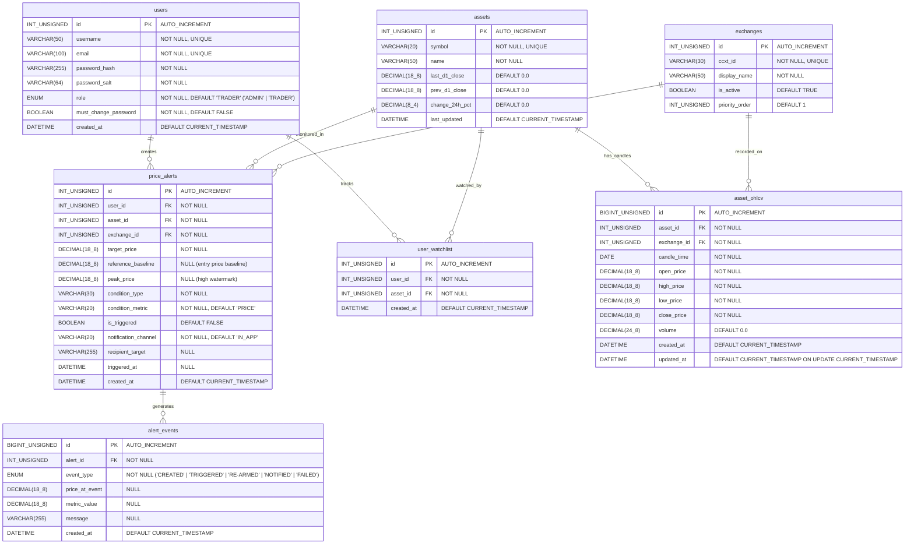

# Relational Database Schema Specification

This document details the complete 6-table relational schema for the **Cryptocurrency Price Alert & Market Tracking Dashboard** (`crypto_alerts_db`).

---

## 1. Entity-Relationship Diagram

---

## 2. Table Specifications

### 2.1 `users`
Stores user identities, hashed credentials, and system RBAC privileges.
- **Primary Key:** `id` (`INT UNSIGNED AUTO_INCREMENT`)
- **Indexes:** `uq_users_username` (`username`), `uq_users_email` (`email`)
- **Fields:**
  - `id`: Unique user identifier.
  - `username`: User login handle (alphanumeric, max 50 chars).
  - `email`: User email address for notifications and identification.
  - `password_hash`: SHA-256 / scrypt derived key hash.
  - `password_salt`: 16-byte cryptographically secure random salt hex string.
  - `role`: Role-based access control level: strict `ENUM('ADMIN', 'TRADER')`, defaulting to `'TRADER'`.
  - `must_change_password`: Boolean flag enforcing password reset on initial credential rotation.
  - `created_at`: Registration timestamp.

### 2.2 `exchanges`
Configured crypto exchanges supported via CCXT (e.g., OKX, Binance, Kraken).
- **Primary Key:** `id` (`INT UNSIGNED AUTO_INCREMENT`)
- **Indexes:** `uq_exchanges_ccxt_id` (`ccxt_id`)
- **Fields:**
  - `id`: Exchange identifier.
  - `ccxt_id`: Official CCXT exchange driver ID (`okx`, `binance`, `kraken`, `bybit`, `coinbase`).
  - `display_name`: Human-readable label (e.g. `'OKX Singapore'`, `'Binance'`).
  - `is_active`: Toggle flag enabling/disabling ticker syncing from this exchange.
  - `priority_order`: Display priority for order book or screener prioritization.

### 2.3 `assets`
Master cryptocurrency symbols tracked by the system.
- **Primary Key:** `id` (`INT UNSIGNED AUTO_INCREMENT`)
- **Indexes:** `uq_assets_symbol` (`symbol`)
- **Fields:**
  - `id`: Asset identifier.
  - `symbol`: Trading pair symbol formatted in CCXT standard (e.g., `'BTC/USDT'`).
  - `name`: Clean asset name (e.g., `'Bitcoin'`). Sanitized against XSS injection (`[<>"\'&]`).
  - `last_d1_close`: Latest resolved D1 closing price across connected exchanges.
  - `prev_d1_close`: Prior day D1 closing price used for 24-hour baseline calculations.
  - `change_24h_pct`: Calculated 24-hour percentage change: `((last_d1_close - prev_d1_close) / prev_d1_close) * 100`.
  - `last_updated`: Timestamp of last successful market price synchronization.

### 2.4 `price_alerts`
User-defined alert rules evaluated against incoming market data.
- **Primary Key:** `id` (`INT UNSIGNED AUTO_INCREMENT`)
- **Foreign Keys:**
  - `user_id` -> `users(id)` (`ON DELETE CASCADE`)
  - `asset_id` -> `assets(id)` (`ON DELETE CASCADE`)
  - `exchange_id` -> `exchanges(id)` (`ON DELETE RESTRICT`)
- **Fields:**
  - `id`: Alert rule identifier.
  - `user_id`: Owning user ID (enforces multi-tenant data isolation).
  - `asset_id`: Monitored asset.
  - `exchange_id`: Reference exchange for price feeds.
  - `target_price`: Absolute target price threshold or relative threshold percentage.
  - `reference_baseline`: Entry price or initial reference level for relative metric alerts.
  - `peak_price`: High watermark price for dynamic trailing stop conditions.
  - `condition_type`: Condition evaluation algorithm:
    - `ABOVE`: Price rises above target.
    - `BELOW`: Price drops below target.
    - `PCT_CHANGE_24H_ABOVE`: 24h percentage change rises above threshold.
    - `PCT_CHANGE_24H_BELOW`: 24h percentage change drops below threshold.
    - `TRAILING_STOP`: Trailing deviation from peak high watermark.
  - `condition_metric`: Metric dimension: `'PRICE'`, `'PCT_CHANGE_24H'`, or `'TRAILING_STOP'`.
  - `is_triggered`: Boolean flag. One-way state transition (`FALSE` -> `TRUE`). Triggered alerts remain triggered until acknowledged or recreated.
  - `notification_channel`: Delivery target: `'IN_APP'`, `'EMAIL'`, `'TELEGRAM'`, `'DISCORD'`.
  - `recipient_target`: Target webhook, email, or chat identifier.
  - `triggered_at`: Timestamp when the condition evaluated to true.
  - `created_at`: Rule creation timestamp.

### 2.5 `asset_ohlcv`
Historical daily (D1) candlestick data partitioned per asset and exchange for technical charting.
- **Primary Key:** `id` (`BIGINT UNSIGNED AUTO_INCREMENT`)
- **Unique Constraint:** `uq_asset_exchange_candle` (`asset_id`, `exchange_id`, `candle_time`)
- **Foreign Keys:**
  - `asset_id` -> `assets(id)` (`ON DELETE CASCADE`)
  - `exchange_id` -> `exchanges(id)` (`ON DELETE CASCADE`)
- **Fields:**
  - `id`: Unique record identifier.
  - `asset_id`: Monitored asset reference.
  - `exchange_id`: Source exchange identifier.
  - `candle_time`: Calendar date of the D1 candle (`DATE`).
  - `open_price`: Opening price (`DECIMAL(18, 8)`).
  - `high_price`: Highest traded price of the session (`DECIMAL(18, 8)`).
  - `low_price`: Lowest traded price of the session (`DECIMAL(18, 8)`).
  - `close_price`: Official closing price of the session (`DECIMAL(18, 8)`).
  - `volume`: Daily aggregate trade volume (`DECIMAL(24, 8)`).
  - `created_at`: Record creation timestamp.
  - `updated_at`: Last sync or recalculation timestamp.

### 2.6 `user_watchlist`
Join table providing isolated per-user watchlist memberships.
- **Primary Key:** `id` (`INT UNSIGNED AUTO_INCREMENT`)
- **Unique Constraint:** `uq_user_asset_watchlist` (`user_id`, `asset_id`)
- **Foreign Keys:**
  - `user_id` -> `users(id)` (`ON DELETE CASCADE`)
  - `asset_id` -> `assets(id)` (`ON DELETE CASCADE`)
- **Fields:**
  - `id`: Watchlist entry identifier.
  - `user_id`: Reference to user adding the asset.
  - `asset_id`: Reference to master asset.
  - `created_at`: Watchlist addition timestamp.

### 2.7 `alert_events`
Audit trail and historical timeline of alert lifecycle state changes (solves C1 trigger and C9 dispatch visibility).
- **Primary Key:** `id` (`BIGINT UNSIGNED AUTO_INCREMENT`)
- **Indexes:** `idx_alert_events_alert_id` (`alert_id`), `idx_alert_events_created_at` (`created_at`)
- **Foreign Keys:**
  - `alert_id` -> `price_alerts(id)` (`ON DELETE CASCADE`)
- **Fields:**
  - `id`: Event record identifier.
  - `alert_id`: Monitored alert reference.
  - `event_type`: Event kind: `CREATED`, `TRIGGERED`, `RE-ARMED`, `NOTIFIED`, or `FAILED`.
  - `price_at_event`: Market price at the moment the event occurred.
  - `metric_value`: Evaluated metric (threshold, 24h %, or trailing stop drawdown).
  - `message`: Diagnostic log or dispatch delivery note.
  - `created_at`: Event timestamp.
