# Relational Database Schema Specification

This document details the complete 10-table relational schema for the **Cryptocurrency Price Alert & Market Tracking Dashboard** (`crypto_alerts_db`), incorporating all latest features across multi-timeframe candles, technical indicators, portfolio tracking, audit trail, notification reliability, and scoped personal API tokens.

---

## 1. Entity-Relationship Diagram

```mermaid
erDiagram
    users ||--o{ price_alerts : "creates"
    users ||--o{ user_watchlist : "curates"
    users ||--o| user_notification_preferences : "configures"
    users ||--o{ notification_log : "receives"
    users ||--o{ api_tokens : "generates"

    assets ||--o{ price_alerts : "monitored_in"
    assets ||--o{ asset_ohlcv : "has_candles"
    assets ||--o{ user_watchlist : "tracked_in"

    exchanges ||--o{ price_alerts : "priced_on"
    exchanges ||--o{ asset_ohlcv : "recorded_on"

    price_alerts ||--o{ alert_events : "generates_audit"
    price_alerts ||--o{ notification_log : "triggers_dispatch"

    users {
        INT_UNSIGNED id PK "AUTO_INCREMENT"
        VARCHAR(50) username "NOT NULL, UNIQUE"
        VARCHAR(100) email "NOT NULL, UNIQUE"
        VARCHAR(255) password_hash "NOT NULL (PBKDF2/scrypt)"
        VARCHAR(64) password_salt "NOT NULL (16-byte hex)"
        ENUM role "NOT NULL, DEFAULT 'TRADER' ('ADMIN' | 'TRADER')"
        BOOLEAN must_change_password "NOT NULL, DEFAULT FALSE"
        DATETIME created_at "DEFAULT CURRENT_TIMESTAMP"
    }

    exchanges {
        INT_UNSIGNED id PK "AUTO_INCREMENT"
        VARCHAR(30) ccxt_id "NOT NULL, UNIQUE"
        VARCHAR(50) display_name "NOT NULL"
        BOOLEAN is_active "DEFAULT TRUE"
        INT_UNSIGNED priority_order "DEFAULT 1"
    }

    assets {
        INT_UNSIGNED id PK "AUTO_INCREMENT"
        VARCHAR(20) symbol "NOT NULL, UNIQUE (e.g. BTC/USDT)"
        VARCHAR(50) name "NOT NULL"
        DECIMAL(18_8) last_d1_close "DEFAULT 0.0"
        DECIMAL(18_8) prev_d1_close "DEFAULT 0.0"
        DECIMAL(8_4) change_24h_pct "DEFAULT 0.0"
        DATETIME last_updated "DEFAULT CURRENT_TIMESTAMP"
    }

    price_alerts {
        INT_UNSIGNED id PK "AUTO_INCREMENT"
        INT_UNSIGNED user_id FK "NOT NULL"
        INT_UNSIGNED asset_id FK "NOT NULL"
        INT_UNSIGNED exchange_id FK "NOT NULL"
        DECIMAL(18_8) target_price "NOT NULL"
        DECIMAL(18_8) reference_baseline "NULL (entry baseline price)"
        DECIMAL(18_8) peak_price "NULL (high watermark)"
        VARCHAR(40) condition_type "NOT NULL"
        VARCHAR(30) condition_metric "NOT NULL, DEFAULT 'PRICE'"
        BOOLEAN is_triggered "DEFAULT FALSE"
        VARCHAR(20) notification_channel "NOT NULL, DEFAULT 'IN_APP'"
        VARCHAR(255) recipient_target "NULL (encrypted at rest)"
        DATETIME triggered_at "NULL"
        DATETIME created_at "DEFAULT CURRENT_TIMESTAMP"
    }

    asset_ohlcv {
        BIGINT_UNSIGNED id PK "AUTO_INCREMENT"
        INT_UNSIGNED asset_id FK "NOT NULL"
        INT_UNSIGNED exchange_id FK "NOT NULL"
        VARCHAR(10) timeframe "NOT NULL, DEFAULT '1d' ('1h' | '4h' | '1d' | '1w')"
        DATETIME candle_time "NOT NULL"
        DECIMAL(18_8) open_price "NOT NULL"
        DECIMAL(18_8) high_price "NOT NULL"
        DECIMAL(18_8) low_price "NOT NULL"
        DECIMAL(18_8) close_price "NOT NULL"
        DECIMAL(24_8) volume "DEFAULT 0.0"
        DATETIME created_at "DEFAULT CURRENT_TIMESTAMP"
        DATETIME updated_at "DEFAULT CURRENT_TIMESTAMP ON UPDATE CURRENT_TIMESTAMP"
    }

    user_watchlist {
        INT_UNSIGNED id PK "AUTO_INCREMENT"
        INT_UNSIGNED user_id FK "NOT NULL"
        INT_UNSIGNED asset_id FK "NOT NULL"
        INT_UNSIGNED sort_order "DEFAULT 0"
        BOOLEAN is_pinned "DEFAULT FALSE"
        DECIMAL(18_8) holding_qty "NULL (portfolio units)"
        DECIMAL(18_8) avg_cost "NULL (cost basis per unit)"
        DATETIME created_at "DEFAULT CURRENT_TIMESTAMP"
    }

    alert_events {
        BIGINT_UNSIGNED id PK "AUTO_INCREMENT"
        INT_UNSIGNED alert_id FK "NOT NULL"
        ENUM event_type "NOT NULL ('CREATED' | 'TRIGGERED' | 'RE-ARMED' | 'NOTIFIED' | 'FAILED')"
        DECIMAL(18_8) price_at_event "NULL"
        DECIMAL(18_8) metric_value "NULL"
        VARCHAR(255) message "NULL"
        DATETIME created_at "DEFAULT CURRENT_TIMESTAMP"
    }

    user_notification_preferences {
        INT_UNSIGNED id PK "AUTO_INCREMENT"
        INT_UNSIGNED user_id FK "NOT NULL, UNIQUE"
        VARCHAR(20) default_channel "DEFAULT 'IN_APP'"
        VARCHAR(500) telegram_target "NULL (encrypted)"
        VARCHAR(500) discord_target "NULL (encrypted)"
        VARCHAR(255) email_target "NULL"
        BOOLEAN quiet_hours_enabled "DEFAULT FALSE"
        TIME quiet_hours_start "DEFAULT '22:00:00'"
        TIME quiet_hours_end "DEFAULT '07:00:00'"
        VARCHAR(50) timezone "DEFAULT 'Asia/Singapore'"
        DATETIME created_at "DEFAULT CURRENT_TIMESTAMP"
        DATETIME updated_at "DEFAULT CURRENT_TIMESTAMP ON UPDATE CURRENT_TIMESTAMP"
    }

    notification_log {
        BIGINT_UNSIGNED id PK "AUTO_INCREMENT"
        INT_UNSIGNED alert_id FK "NULL"
        INT_UNSIGNED user_id FK "NOT NULL"
        VARCHAR(20) channel "NOT NULL"
        VARCHAR(500) recipient_target "NULL (masked/encrypted)"
        ENUM status "NOT NULL ('PENDING' | 'SENT' | 'FAILED' | 'RETRYING' | 'SUPPRESSED')"
        INT_UNSIGNED attempt_count "DEFAULT 0"
        INT_UNSIGNED max_attempts "DEFAULT 3"
        DATETIME next_retry_at "NULL"
        TEXT last_error "NULL"
        TEXT message_payload "NULL"
        DATETIME sent_at "NULL"
        DATETIME created_at "DEFAULT CURRENT_TIMESTAMP"
    }

    api_tokens {
        INT_UNSIGNED id PK "AUTO_INCREMENT"
        INT_UNSIGNED user_id FK "NOT NULL"
        VARCHAR(100) name "NOT NULL (e.g. Trading Bot Script)"
        VARCHAR(16) token_prefix "NOT NULL (e.g. cpat_a1b2c3d4)"
        VARCHAR(64) token_hash "NOT NULL (SHA-256)"
        VARCHAR(255) scopes "NOT NULL, DEFAULT 'read:alerts'"
        DATETIME last_used_at "NULL"
        DATETIME expires_at "NULL"
        DATETIME created_at "DEFAULT CURRENT_TIMESTAMP"
    }
```

---

## 2. Table Specifications

### 2.1 `users`
Stores user identities, hashed credentials, and system RBAC privileges.
- **Primary Key:** `id` (`INT UNSIGNED AUTO_INCREMENT`)
- **Indexes:** `uq_users_username` (`username`), `uq_users_email` (`email`)
- **Fields:**
  - `id`: Unique user identifier.
  - `username`: User login handle (alphanumeric, max 50 chars).
  - `email`: User email address for notifications and identification.
  - `password_hash`: Cryptographically derived password hash (PBKDF2 with SHA-512, 100,000 iterations).
  - `password_salt`: 16-byte cryptographically secure random salt hex string.
  - `role`: Role-based access control level: strict `ENUM('ADMIN', 'TRADER')`, defaulting to `'TRADER'`.
  - `must_change_password`: Boolean flag enforcing password reset on initial credential rotation.
  - `created_at`: Registration timestamp.

### 2.2 `exchanges`
Configured crypto exchanges supported via CCXT (e.g., OKX Singapore, Binance Global, Offline Mock).
- **Primary Key:** `id` (`INT UNSIGNED AUTO_INCREMENT`)
- **Indexes:** `uq_exchanges_ccxt_id` (`ccxt_id`)
- **Fields:**
  - `id`: Exchange identifier.
  - `ccxt_id`: Official CCXT exchange driver ID (`okx`, `binance`, `kraken`, `bybit`, `local_mock`).
  - `display_name`: Human-readable label (e.g. `'OKX Singapore'`, `'Binance'`).
  - `is_active`: Toggle flag enabling/disabling ticker syncing from this exchange.
  - `priority_order`: Display and resolution priority for ticker order book synchronization.

### 2.3 `assets`
Master cryptocurrency symbols tracked by the system.
- **Primary Key:** `id` (`INT UNSIGNED AUTO_INCREMENT`)
- **Indexes:** `uq_assets_symbol` (`symbol`)
- **Fields:**
  - `id`: Asset identifier.
  - `symbol`: Trading pair symbol formatted in CCXT standard (e.g., `'BTC/USDT'`).
  - `name`: Clean asset name (e.g., `'Bitcoin'`). Sanitized against XSS injection (`[<>"\'&]`).
  - `last_d1_close`: Latest resolved D1 closing price across connected exchanges.
  - `prev_d1_close`: Prior day D1 closing price used for 24-hour baseline calculations.
  - `change_24h_pct`: Calculated 24-hour percentage change: `((last_d1_close - prev_d1_close) / prev_d1_close) * 100`.
  - `last_updated`: Timestamp of last successful market price synchronization.

### 2.4 `price_alerts`
User-defined alert rules evaluated against incoming market data.
- **Primary Key:** `id` (`INT UNSIGNED AUTO_INCREMENT`)
- **Foreign Keys:**
  - `user_id` -> `users(id)` (`ON DELETE CASCADE`)
  - `asset_id` -> `assets(id)` (`ON DELETE CASCADE`)
  - `exchange_id` -> `exchanges(id)` (`ON DELETE RESTRICT`)
- **Fields:**
  - `id`: Alert rule identifier.
  - `user_id`: Owning user ID (enforces multi-tenant data isolation).
  - `asset_id`: Monitored asset.
  - `exchange_id`: Reference exchange for price feeds.
  - `target_price`: Absolute target price threshold or relative threshold percentage.
  - `reference_baseline`: Entry price or initial reference level for relative metric alerts.
  - `peak_price`: High watermark price for dynamic trailing stop conditions.
  - `condition_type`: Condition evaluation algorithm:
    - Absolute: `ABOVE`, `BELOW`
    - Relative Return: `PCT_CHANGE_24H_ABOVE`, `PCT_CHANGE_24H_BELOW`
    - Risk Management: `TRAILING_STOP`
    - Technical Indicators: `RSI_ABOVE`, `RSI_BELOW`, `SMA_GOLDEN_CROSS`, `SMA_DEATH_CROSS`, `VOLUME_SPIKE`
  - `condition_metric`: Metric dimension: `'PRICE'`, `'PCT_CHANGE_24H'`, `'TRAILING_STOP'`, `'RSI_14'`, `'SMA_CROSS'`, `'VOLUME_SPIKE'`.
  - `is_triggered`: Boolean flag. One-way state transition (`FALSE` -> `TRUE`). Triggered alerts remain triggered until acknowledged or re-armed.
  - `notification_channel`: Delivery target: `'IN_APP'`, `'EMAIL'`, `'TELEGRAM'`, `'DISCORD'`.
  - `recipient_target`: Target webhook, email, or chat identifier (encrypted at rest).
  - `triggered_at`: Timestamp when the condition evaluated to true.
  - `created_at`: Rule creation timestamp.

### 2.5 `asset_ohlcv`
Multi-timeframe historical candlestick series partitioned per asset, exchange, and timeframe for technical indicators and interactive charts.
- **Primary Key:** `id` (`BIGINT UNSIGNED AUTO_INCREMENT`)
- **Unique Constraint:** `uq_asset_exchange_tf_candle` (`asset_id`, `exchange_id`, `timeframe`, `candle_time`)
- **Indexes:** `idx_asset_ohlcv_asset` (`asset_id`)
- **Foreign Keys:**
  - `asset_id` -> `assets(id)` (`ON DELETE CASCADE`)
  - `exchange_id` -> `exchanges(id)` (`ON DELETE CASCADE`)
- **Fields:**
  - `id`: Unique record identifier.
  - `asset_id`: Monitored asset reference.
  - `exchange_id`: Source exchange identifier.
  - `timeframe`: Granularity window: `'1h'`, `'4h'`, `'1d'`, or `'1w'`.
  - `candle_time`: Timestamp of the candle open (`DATETIME`).
  - `open_price`: Opening price (`DECIMAL(18, 8)`).
  - `high_price`: Highest traded price of the session (`DECIMAL(18, 8)`).
  - `low_price`: Lowest traded price of the session (`DECIMAL(18, 8)`).
  - `close_price`: Official closing price of the session (`DECIMAL(18, 8)`).
  - `volume`: Aggregate trade volume (`DECIMAL(24, 8)`).
  - `created_at`: Record creation timestamp.
  - `updated_at`: Last sync timestamp (`ON UPDATE CURRENT_TIMESTAMP`).

### 2.6 `user_watchlist`
Per-user personalized watchlist curation and portfolio holdings tracking.
- **Primary Key:** `id` (`INT UNSIGNED AUTO_INCREMENT`)
- **Unique Constraint:** `uq_user_asset_watchlist` (`user_id`, `asset_id`)
- **Indexes:** `idx_user_watchlist_order` (`user_id`, `is_pinned DESC`, `sort_order ASC`)
- **Foreign Keys:**
  - `user_id` -> `users(id)` (`ON DELETE CASCADE`)
  - `asset_id` -> `assets(id)` (`ON DELETE CASCADE`)
- **Fields:**
  - `id`: Watchlist entry identifier.
  - `user_id`: Reference to user adding the asset.
  - `asset_id`: Reference to master asset.
  - `sort_order`: Drag-and-drop custom order sequence integer.
  - `is_pinned`: Boolean flag to pin favorite assets to the top of the ribbon.
  - `holding_qty`: Portfolio asset units held (e.g. `0.75` BTC) for unrealised P/L tracking.
  - `avg_cost`: Weighted average purchase cost basis per unit in USDT.
  - `created_at`: Watchlist addition timestamp.

### 2.7 `alert_events`
Audit trail and historical timeline of alert lifecycle state changes (solves C1 trigger and C9 dispatch visibility).
- **Primary Key:** `id` (`BIGINT UNSIGNED AUTO_INCREMENT`)
- **Indexes:** `idx_alert_events_alert_id` (`alert_id`), `idx_alert_events_created_at` (`created_at`)
- **Foreign Keys:**
  - `alert_id` -> `price_alerts(id)` (`ON DELETE CASCADE`)
- **Fields:**
  - `id`: Event record identifier.
  - `alert_id`: Monitored alert reference.
  - `event_type`: Event kind: `CREATED`, `TRIGGERED`, `RE-ARMED`, `NOTIFIED`, or `FAILED`.
  - `price_at_event`: Market price at the moment the event occurred.
  - `metric_value`: Evaluated metric (threshold, 24h %, RSI, SMA, or drawdown).
  - `message`: Diagnostic log or dispatch delivery note.
  - `created_at`: Event timestamp.

### 2.8 `user_notification_preferences`
Per-user notification delivery settings, quiet hours schedule, and encrypted target endpoints.
- **Primary Key:** `id` (`INT UNSIGNED AUTO_INCREMENT`)
- **Unique Constraint:** `user_id`
- **Foreign Keys:**
  - `user_id` -> `users(id)` (`ON DELETE CASCADE`)
- **Fields:**
  - `id`: Preference record identifier.
  - `user_id`: Owning user identifier.
  - `default_channel`: Fallback notification channel (`'IN_APP'`, `'EMAIL'`, `'TELEGRAM'`, `'DISCORD'`).
  - `telegram_target`: AES-256-GCM encrypted Telegram chat ID or bot token.
  - `discord_target`: AES-256-GCM encrypted Discord webhook URL.
  - `email_target`: Verified notification recipient email.
  - `quiet_hours_enabled`: Boolean flag toggling nighttime notification suppression.
  - `quiet_hours_start`: Suppression window start time (e.g. `22:00:00`).
  - `quiet_hours_end`: Suppression window end time (e.g. `07:00:00`).
  - `timezone`: User local timezone for accurate quiet-hours calculation (default `'Asia/Singapore'`).
  - `created_at`: Initial preference setup timestamp.
  - `updated_at`: Last preference update timestamp.

### 2.9 `notification_log`
Reliability tracking, exponential backoff retries, and delivery audit log for all dispatched alerts.
- **Primary Key:** `id` (`BIGINT UNSIGNED AUTO_INCREMENT`)
- **Indexes:** `idx_notif_user_status` (`user_id`, `status`), `idx_notif_retry` (`status`, `next_retry_at`)
- **Foreign Keys:**
  - `alert_id` -> `price_alerts(id)` (`ON DELETE SET NULL`)
  - `user_id` -> `users(id)` (`ON DELETE CASCADE`)
- **Fields:**
  - `id`: Delivery attempt log identifier.
  - `alert_id`: Associated alert rule reference.
  - `user_id`: Recipient user reference.
  - `channel`: Transport channel (`EMAIL`, `TELEGRAM`, `DISCORD`, `IN_APP`).
  - `recipient_target`: Masked target string for privacy (`t****@example.com`).
  - `status`: Delivery state: `PENDING`, `SENT`, `FAILED`, `RETRYING`, or `SUPPRESSED`.
  - `attempt_count`: Number of transmission attempts made.
  - `max_attempts`: Retry threshold cap (default 3).
  - `next_retry_at`: Scheduled timestamp for exponential backoff retry.
  - `last_error`: Diagnostic error message or HTTP response code from webhook/SMTP.
  - `message_payload`: Full text of formatted alert message.
  - `sent_at`: Timestamp of confirmed successful transmission.
  - `created_at`: Initial dispatch request timestamp.

### 2.10 `api_tokens`
Scoped, revocable Personal Access Tokens (PAT) empowering external automation scripts and REST API consumers.
- **Primary Key:** `id` (`INT UNSIGNED AUTO_INCREMENT`)
- **Indexes:** `idx_api_tokens_hash` (`token_hash`), `idx_api_tokens_user` (`user_id`)
- **Foreign Keys:**
  - `user_id` -> `users(id)` (`ON DELETE CASCADE`)
- **Fields:**
  - `id`: Token record identifier.
  - `user_id`: Owning user identifier.
  - `name`: Descriptive label assigned by the user (e.g. `'TradingView Webhook Bot'`).
  - `token_prefix`: First 10–12 characters of plaintext token for safe UI identification (`cpat_a1b2c3d4`).
  - `token_hash`: SHA-256 hash of secret token string (plaintext secret is never persisted).
  - `scopes`: Comma-separated permission scopes (`read:alerts`, `write:alerts`, `read:markets`, `read:kpi`).
  - `last_used_at`: Timestamp of most recent authenticated API request.
  - `expires_at`: Optional expiration date/time or NULL for persistent tokens.
  - `created_at`: Token generation timestamp.
