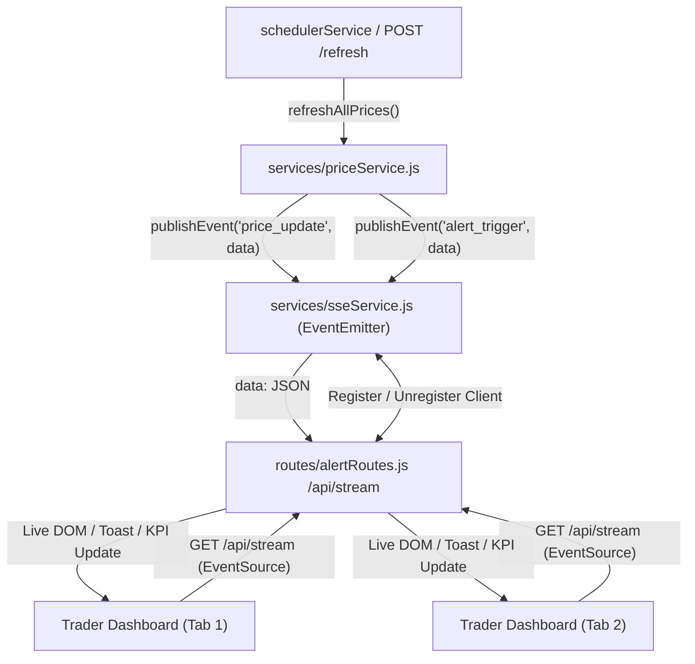

# Implementation Plan: 3.7 Real-Time Updates (Server-Sent Events)

> **Goal**: Implement Server-Sent Events (`/api/stream`) to push live price updates, trigger events, and KPI changes directly to open browser dashboards, eliminating the need for manual browser reloads.

---

## 1. Architecture & Design Overview



### Why Server-Sent Events (SSE)?
1. **Lightweight & Native HTTP**: Operates over standard HTTP (`Content-Type: text/event-stream`), avoiding protocol upgrade overhead, WebSocket server dependencies, or sticky session complexities.
2. **Auto-Reconnection**: The browser's native `EventSource` automatically handles backoff and reconnection without custom retry loops.
3. **Unidirectional Match**: The dashboard strictly consumes server-side price updates and trigger events pushed down from background sync cycles.

---

## 2. Proposed Changes & Components

### 2.1 Central Event Stream Hub (`services/sseService.js`)
Create a dedicated SSE manager module leveraging Node.js `EventEmitter`:
- **Client Management**:
  - `addClient(userId, res)`: Sets up headers (`text/event-stream`, `Cache-Control: no-cache`, `Connection: keep-alive`), sends initial connection handshake (`event: connected`), and stores the active response connection.
  - `removeClient(res)`: Cleans up listeners and removes connections upon `req.on('close')`.
  - Heartbeat / Keep-Alive ping (`: ping\n\n`) every 25 seconds to prevent reverse proxy/load balancer idle timeouts.
- **Broadcast Methods**:
  - `broadcastPriceUpdate(updatedAssets)`: Pushes updated asset close prices, 24h percentage changes, and timestamps to all active clients.
  - `broadcastAlertTrigger(triggeredAlerts)`: Pushes newly triggered alert events (symbol, condition, market price, triggered_at). Targets specific `user_id` when scoped, or all subscribers.
  - `broadcastKPIUpdate(kpiMetrics)`: Pushes refreshed total tracked pairs, active alerts count, and triggered count.

### 2.2 Integration with Price & Alert Engine (`services/priceService.js`)
Hook SSE broadcasting into `refreshAllPrices()`:
- After `updatedAssets` are written to the database, trigger `sseService.broadcastPriceUpdate(updatedAssets)`.
- When `newlyTriggeredAlerts` are detected, trigger `sseService.broadcastAlertTrigger(newlyTriggeredAlerts)`.
- When active/triggered counts are queried, trigger `sseService.broadcastKPIUpdate(...)`.

### 2.3 Express Stream Endpoint (`routes/alertRoutes.js`)
Add the authenticated SSE route:
```http
GET /api/stream
Headers:
  Cookie: jwt_token=<valid_token>
```
- Protected by `requireAuth`.
- Streams standard SSE event types:
  - `event: connected`: Initial welcome packet with client ID and timestamp.
  - `event: price_update`: Array of refreshed assets with updated prices and 24h change percentages.
  - `event: alert_trigger`: Fired when alerts transition to triggered, including alert ID, symbol, target, condition, and market price.
  - `event: kpi_update`: Refreshed aggregate metrics for the dashboard KPI ribbon.

### 2.4 Client-Side Real-Time Dashboard Controller (`public/js/realtime.js`)
Create a frontend controller included in `views/index.ejs`:
1. **Interactive Toggle Control (On/Off)**:
   - Surface a dedicated toggle switch in the navbar or KPI header:
     - `[ 🟢 Live Sync: ON / OFF ]` switch button or toggle element (`#toggleRealtimeSync`).
     - State persistence in browser `localStorage` (`crypto_realtime_sync_enabled: "true" | "false"`, defaulting to `true`).
     - When toggled **OFF**:
       - Closes the active `EventSource` connection (`eventSource.close()`).
       - Updates the status badge to `⚪ Live Sync: Paused` or `Disabled`.
       - Stops live DOM animations, chart refreshes, and toast popups to save bandwidth/battery.
     - When toggled **ON**:
       - Instantiates `new EventSource('/api/stream')`.
       - Re-attaches listeners and transitions badge to `🟢 Live Sync: Active`.
2. **Connection Lifecycle & Status Badge**:
   - Displays real-time status:
     - `🟢 Live Sync` (connected)
     - `🟡 Connecting...`
     - `⚪ Paused` (toggled off by user)
     - `🔴 Disconnected` (error / retry)
3. **DOM Patching**:
   - **Watchlist & Price Strip**: Updates prices and color flashes (green for increase, red for drop).
   - **Alerts Table**: Transitions rows to `🔴 TRIGGERED` live without reloading.
   - **KPI Ribbon**: Dynamically increments triggered alert counter and updates total active alerts.
   - **Toast / Notification**: Shows a Bootstrap 5 floating toast alert: `🚨 Alert Triggered: BTC/USDT crossed above $95,000`.
   - **Candlestick Chart Refresh**: Signals `chart.js` to reload the active asset series seamlessly when a new candle closes.

---

## 3. Detailed Verification Plan

### Automated Tests
1. **Unit Tests (`test/unit.test.js`)**:
   - Verify `sseService` adds, tracks, and cleans up active clients on close.
   - Verify heartbeat ping formatting (`: ping\n\n`) and event packet structuring (`event: price_update\ndata: ...\n\n`).
2. **Route Integration Tests (`test/routes.test.js`)**:
   - `GET /api/stream` requires authentication (redirects or 401 when unauthenticated).
   - `GET /api/stream` returns `200 OK` with `Content-Type: text/event-stream`.
   - Receiving simulated price updates and trigger events over the open stream buffer.
3. **Regressions**:
   - Run complete suite (`npm test`) in both `crypto_alerts` and root `cico` to ensure 100% passing tests (87/87 + 28/28).

---

## 4. Implementation Steps Summary

| Step | Action | Files |
|---|---|---|
| **1** | Create SSE event broker & client manager | `crypto_alerts/services/sseService.js` |
| **2** | Connect event broadcasts into price refresh & trigger detection | `crypto_alerts/services/priceService.js` |
| **3** | Add `GET /api/stream` endpoint with auth | `crypto_alerts/routes/alertRoutes.js` |
| **4** | Build frontend live sync listener, DOM patcher & On/Off toggle switch with localStorage persistence | `crypto_alerts/public/js/realtime.js`, `views/index.ejs`, `views/partials/navbar.ejs` |
| **5** | Add automated unit and route integration tests | `crypto_alerts/test/unit.test.js`, `test/routes.test.js` |
| **6** | Verify full test suite passes | Run `npm test` |
