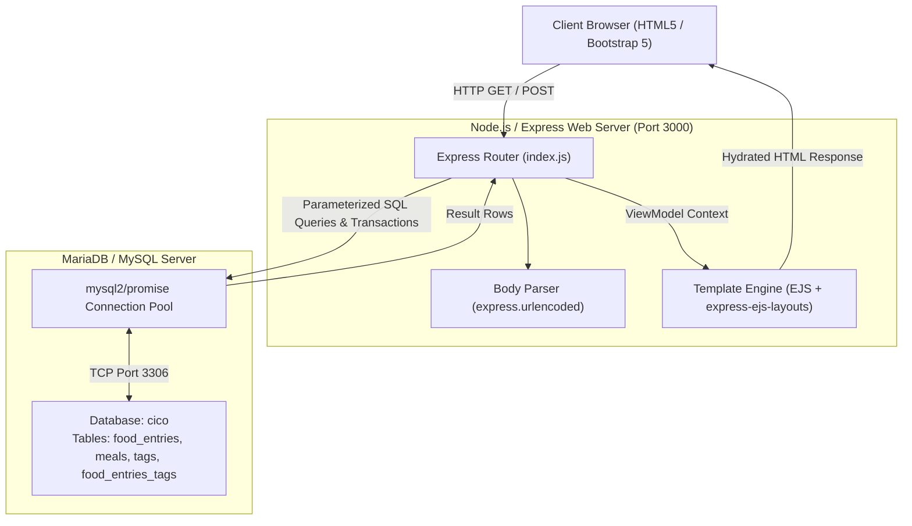
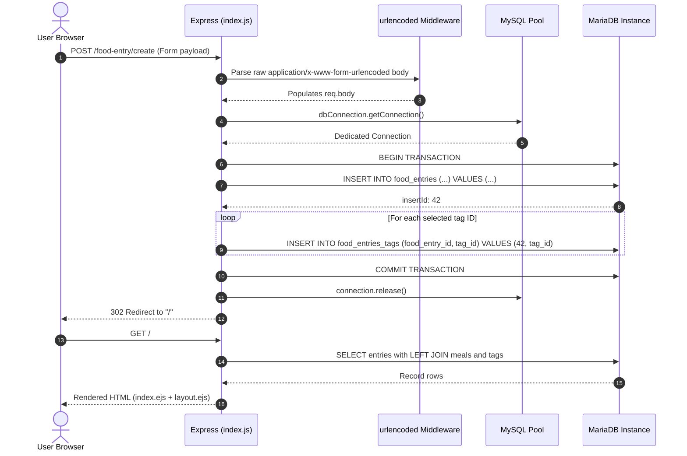

# Technical Documentation: CICO (Calories In, Calories Out) Tracker

This technical documentation describes the architecture, codebase organization, operational data flow, and development procedures for the **CICO Tracker** application.

---

## 1. Architecture Overview

The CICO Tracker is a **Server-Side Rendered (SSR) MVC web application** built with **Express 5**, **MariaDB/MySQL**, and **EJS templates**.



### Architecture Highlights:
- **Presentation Layer (View):** Built using EJS templates structured with `express-ejs-layouts`. Common shell components (`navigation.ejs`, `footer.ejs`) wrap dynamic page views.
- **Application Layer (Controller & Routing):** `index.js` handles HTTP routing, query handling, input parsing, error capturing, and view dispatching.
- **Data Access Layer (Model):** Interacts with MariaDB using `mysql2/promise` with a configured connection pool. Complex updates use ACID transactions (`beginTransaction`, `commit`, `rollback`) to preserve referential integrity across Many-to-Many associations.


---

## 2. Project Structure

The project layout as organized in VS Code:

```
cico/
├── .env                              # Active environment variables (Host, credentials, port)
├── .env example                      # Sample configuration template
├── .gitignore                        # Git ignore rules (node_modules, .env)
├── package.json                      # Application manifest, dependencies, and metadata
├── package-lock.json                 # Dependency lockfile
├── README.md                         # Project documentation and database connection hint
├── runmysql.sh                       # Linux shell script helper to connect to MariaDB CLI
├── runmysql.bat                      # Windows batch script helper to connect to MariaDB CLI
├── index.js                          # Main application entry point, server setup, and route handlers
│
├── docs/                             # Architecture and schema documentation
│   ├── TECHNICAL_DOCUMENTATION.md    # Technical system documentation (this file)
│   └── cico_tracker (.env) - cico_tracker - Diagram.html  # Exported DBCode ERD diagram
│
├── migrations/                       # SQL schema and seed scripts
│   ├── 01_add_meals_table.sql        # Creates meals table
│   ├── 02_add_food_entries_meals_fk.sql # Foreign key constraint for meals
│   ├── 03_migrate_existing_meals.sql # Data migration script for meal records
│   └── 04_add_tags_table.sql         # Tags and food_entries_tags junction table
│
└── views/                            # EJS templates and components
    ├── layout.ejs                    # Main HTML boilerplate with Bootstrap 5 CDN
    ├── index.ejs                     # Food entries dashboard and search filter view
    ├── create-food-entry.ejs         # Form view to add an entry
    ├── edit-food-entry.ejs           # Form view to update an existing entry
    ├── delete-food-entry.ejs         # Confirmation dialog to delete an entry
    ├── food-entry-form.ejs           # Reusable form field component
    └── partials/
        ├── navigation.ejs            # Global navbar header
        └── footer.ejs                # Global page footer
```

### Key Files and Their Roles
- **`index.js`**: Configures Express middleware (`urlencoded`, layout engine), initializes the MySQL connection pool, and implements all CRUD routes.
- **`views/layout.ejs`**: Defines the primary HTML shell and injects child views (`<%- body %>`) along with Bootstrap 5 assets.
- **`views/food-entry-form.ejs`**: Shared input form fields for creating and editing records.
- **`runmysql.sh`** / **`runmysql.bat`**: Shortcut scripts for connecting directly to the local database terminal.

---

## 3. Setup for Development

### 1. Prerequisites
- **Node.js** >= 18.0.0
- **npm** >= 9.0.0
- **MariaDB** or **MySQL** server running locally (or in Docker) on port `3306`

### 2. Environment Configuration
Clone the repository and duplicate the `.env example` file into `.env`:
```bash
cp ".env example" .env
```
Ensure your `.env` contains valid connection settings:
```env
DB_HOST=127.0.0.1
DB_USER=root
DB_PASSWORD=mariadb
DB_NAME=cico
DB_PORT=3306
```

### 3. Install Dependencies
```bash
npm install
```

### 4. Database Setup & Migrations
Connect to MariaDB and execute the migration scripts sequentially:
```bash
# Connect using the included helper script:
./runmysql.sh

# Or directly execute scripts against your database:
mysql -u root -pmariadb -h 127.0.0.1 cico < migrations/01_add_meals_table.sql
mysql -u root -pmariadb -h 127.0.0.1 cico < migrations/02_add_food_entries_meals_fk.sql
mysql -u root -pmariadb -h 127.0.0.1 cico < migrations/03_migrate_existing_meals.sql
mysql -u root -pmariadb -h 127.0.0.1 cico < migrations/04_add_tags_table.sql
```

### 5. Running the Application
```bash
# For live auto-reloading during development:
npx nodemon index.js

# Or using plain Node:
node index.js
```
The server will boot and log: `Server running at http://localhost:3000`.

---

## 4. Key Modules and Functions

All routing logic is centered in `index.js`.

### 1. Database Pool Initialization
- **Configuration:** `mysql2.createPool(dbConfig)`
- **Behavior:** Pools reusable TCP sockets to MariaDB. `dateStrings: true` ensures DATETIME values from the DB are returned as formatted strings rather than converted to local JavaScript `Date` instances.

### 2. List & Filter Entries (`GET /`)
- **Purpose:** Fetches food entries matching an optional search term along with joined meal and tag data.
- **Inputs:** `req.query.search` (optional search keyword).
- **Outputs:** Renders `views/index.ejs` with `{ pageTitle, foodEntries, searchTerm }`.
- **Logic:**
  ```sql
  SELECT food_entries.id, dateTime, foodName, calories, servingSize, unit, meals.name as 'meal',
         group_concat(tags.name) as 'selected_tags'
  FROM food_entries
  LEFT JOIN meals ON food_entries.meal_id = meals.id
  LEFT JOIN food_entries_tags ON food_entries_tags.food_entry_id = food_entries.id
  LEFT JOIN tags ON food_entries_tags.tag_id = tags.id
  WHERE food_entries.foodName LIKE ?
  GROUP BY food_entries.id, dateTime, foodName, calories, servingSize, unit, meal;
  ```
  Uses `group_concat(tags.name)` to aggregate Many-to-Many tags into a single comma-separated string per row.

### 3. Create Food Entry (`POST /food-entry/create`)
- **Purpose:** Persists a new food entry and establishes junction records in `food_entries_tags`.
- **Inputs:** `req.body` containing `{ dateTime, foodName, calories, meal, servingSize, unit, tags }`.
- **Outputs:** Redirects to `/` on success; rolls back and calls `next(e)` on error.
- **Logic / Algorithm:**
  1. Acquires a dedicated client connection from the pool (`getConnection()`).
  2. Executes `await connection.beginTransaction()`.
  3. Inserts into `food_entries` and captures `results.insertId`.
  4. Deduplicates tags using `[...new Set(req.body.tags || [])]`.
  5. Loops over each tag ID and inserts `(insertId, tagId)` into `food_entries_tags`.
  6. Executes `await connection.commit()`.
  7. In the `finally` block, releases the connection back to the pool.

### 4. Update Food Entry (`POST /food-entry/:id/edit`)
- **Purpose:** Updates existing entry details and synchronizes many-to-many tag associations.
- **Inputs:** `req.params.id`, `req.body` attributes.
- **Outputs:** Redirects to `/`.
- **Logic / Algorithm:**
  1. Starts a database transaction.
  2. Deletes existing tag associations: `DELETE FROM food_entries_tags WHERE food_entry_id = ?`.
  3. Inserts the newly checked tags in a loop.
  4. Runs the `UPDATE food_entries SET ... WHERE id = ?` statement.
  5. Commits the transaction (or rolls back on exceptions).

### 5. Delete Food Entry (`POST /food-entry/:id/delete`)
- **Purpose:** Deletes a specific food record.
- **Inputs:** `req.params.id`.
- **Outputs:** Redirects to `/`.
- **Logic:** Calls `DELETE FROM food_entries WHERE id = ?`. Foreign key `ON DELETE CASCADE` constraints automatically delete associated entries in `food_entries_tags`.

---

## 5. Data Flow

### Example: Creating a New Food Entry



---

## 6. Testing

### Automated Test Suite
The project utilizes the native Node.js test runner (`node:test`) and assertion library (`node:assert/strict`), requiring zero external testing dependencies.

```bash
# Run the complete test suite
npm test
```

### Test Organization (`test/`):
- **Unit Tests ([test/unit.test.js](file:///home/leekwan/code/cico/test/unit.test.js))**:
  - Tests tag deduplication logic with `Set` (`["1", "2", "2"] -> ["1", "2"]`).
  - Tests whitespace trimming and `%...%` wildcard formatting for search queries.
  - Tests fallback defaults (meal ID defaulting to `'1'`).
  - Tests datetime parsing and slicing for datetime-local input controls.
- **Integration Tests ([test/integration.test.js](file:///home/leekwan/code/cico/test/integration.test.js))**:
  - Boots an ephemeral HTTP server on dynamic port (`0`).
  - Mocks the MariaDB connection pool and transactions (`beginTransaction`, `commit`, `rollback`).
  - Tests `GET /` (dashboard with data rendering).
  - Tests `GET /?search=Rice` (SQL wildcard verification).
  - Tests `GET /food-entry/create` (rendering form with meals and tags).
  - Tests `POST /food-entry/create` (HTTP 302 redirect, master entry and junction tag inserts).
  - Tests `GET /food-entry/:id/edit` (rendering form with existing values).
  - Tests `POST /food-entry/:id/edit` (HTTP 302 redirect, clearing existing tags and re-inserting new tags).
  - Tests `GET /food-entry/:id/delete` (rendering confirmation page).
  - Tests `POST /food-entry/:id/delete` (HTTP 302 redirect and deletion query execution).

### Manual Verification Checklist
1. **Health Check:** Ensure `http://localhost:3000` returns HTTP 200 and loads Bootstrap stylesheets without console errors.
2. **Search Verification:**
   - Filter with an existing entry name (e.g. `Chicken`) $\rightarrow$ Verify only matching rows display.
   - Filter with non-existent keyword (e.g. `xyz123`) $\rightarrow$ Verify empty state alert displays.
3. **Transaction Rollback Test:**
   - Temporarily force an error during tag insertion $\rightarrow$ Verify that the master `food_entries` record is not saved (rollback succeeds).
4. **Cascade Deletion Test:**
   - Delete an entry with multiple tags $\rightarrow$ Query `SELECT * FROM food_entries_tags WHERE food_entry_id = <ID>` to verify child junction rows were purged.
